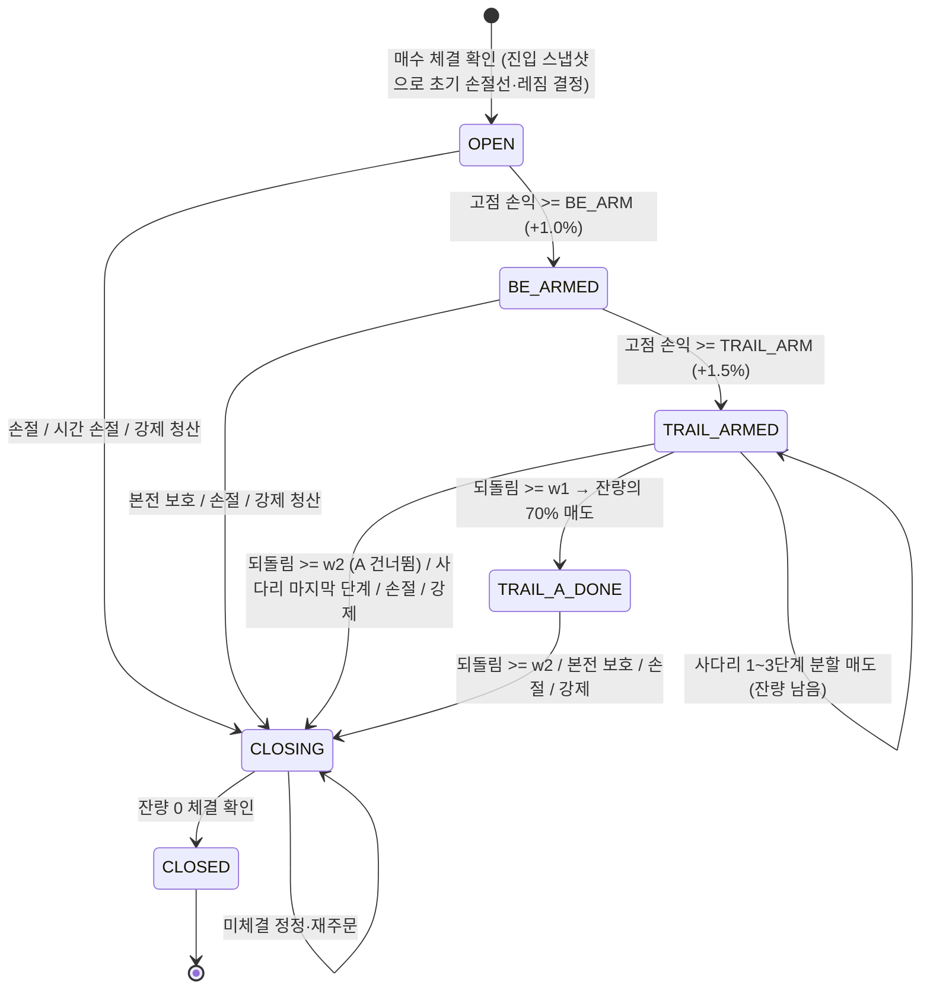

# 적응형 익절·손절 엔진 설계안 (2026-11-15, 설계 단계 - 코드 미작성)

- 요청: 사용자 2026-11-15 "autoboth 매도 조건 변경 구성" (레짐 판별 + 분할 익절 + 동적 되돌림 트레일링 + 유연 손절 + Edge AI 보조)
- 협업: Claude = 설계·구현·테스트, Codex = 설계/코드 독립 검토(`AGENTS.md`), Edge AI = 보조 판단자(규칙 엔진이 최종 결정)
- 상태: **설계 확정(§15 사용자 결정 2026-11-15) → Codex 1차 검토 "수정 후 채택" → §17 반영(2026-11-15).**
  §1~§11과 §17이 충돌하면 **§17이 우선**한다. 검토 원문: `adaptive_exit_codex_review_20261115.md` 아래 수치는 모두 초기값이며 `[BT]` 표시는 백테스트로 확정해야 하는 값이다.
  "가정:"은 요구사항이 모호해 임의로 정한 부분이고, §12 질문 목록에서 사용자가 확정한다.

---

## 0. 먼저 짚어 둘 사실 (기존 코드·분석과의 관계)

1. **현재 실매매 매도는 사실상 수동이다.** r001 `AUTO_SELL_MODE="stop_only"` → r006 `STOP_ONLY_SELL_CONDITIONS`
   (비용 포함 순손익 -2.0% 손절만 자동, 15:20 예약 청산도 건너뜀). 이 엔진은 새 매도 모드로 추가하고, 기존 normal/basic/edge
   매도 조건 목록은 건드리지 않는다.
2. **기존에 비슷한 조각이 이미 있다.** r002 `detect_price_surge`(60초 급등 판정), r006 `_005` TP1 분할, `_006` 급등 사다리,
   `_007` 이익 잠금(+1.0% 이후 0.4% 반납 시 전량), `_010` 본전 실패, `_011` 무추세 시간 청산, `_013` 트레일링. 새 엔진은 이것들을
   한 상태 머신으로 다시 묶는 것이고, 기존 조건 목록과 **동시에 켜지지 않는다**(한 포지션은 한 엔진만 관리).
3. **자체 분석 결과와 맞지 않는 부분이 있다.** `analysis_20261111_timing_study.md` §0·§3:
   청산 조합 572개의 거래당 순손익이 모두 -0.53 ~ -0.80%로 거의 같았고, "급등·상승 추세면 더 들고 간다" 계열은 현행보다
   0.005 ~ 0.04%p **나빴다**(1분봉, 1분 크로스 진입 대용, 틱 미사용). 이 설계의 핵심 가설(급등 레짐에서 목표를 높이고 되돌림
   허용폭을 넓히면 낫다)은 **아직 검증되지 않았다.** 그래서 이 엔진은 **shadow(판단·로그만) → 틱 리플레이 백테스트 → 실주문** 순서로
   켠다(§9). 이 분석에 없던 체결강도·틱 기반 거래량·호가 정보가 차이를 만드는지가 검증 대상이다.
4. **데이터 제약**
   - 틱(H0STCNT0)은 g011 수집기가 `runtime/data/ticks/YYYYMMDD/<code>.csv`에 저장한다. **2026-10-30부터 11거래일**뿐이다.
   - 저장 컬럼: 가격, 체결량, 누적거래량, `ccld_dvsn`(1 매수체결 / 5 매도체결), 매수·매도 체결 건수, 매도1·매수1 호가.
     **체결강도(CTTR) 컬럼은 저장하지 않는다**(웹소켓에는 있음). **호가 총잔량은 웹소켓으로 받지 않는다**(r003이 REST 시세로만 조회).
   - g001 `_10s` 파일은 90거래일 이상 있지만 **실측 10초가 아니라 KIS 1분봉을 10초로 보간한 것**이다(volume = 분 거래량/6).
     RVOL 분모는 `_minutes_from_10s_file()`로 원본 1분봉을 복원해 만든다(§17 C12).
   - Edge AI(r011)는 **진입용 P(win) 모델**이다. 청산용 출력(`continuation_prob`/`reversal_prob`)을 내는 모델은 없다. 새로 학습해야 한다.
5. **평가 주기:** r003 메인 루프는 10초 폴링(`LIVE_PRICE_POLL_INTERVAL_SECONDS=10`)이다. 되돌림 0.6%p를 다루려면 10초는 너무 길다.
   → 보유 종목만 **1초 주기**로 평가하고 가격은 g011 틱 파일(약 1초 단위 flush)을 r013과 같은 방식으로 이어 읽는다. REST 호출은
   늘리지 않는다(§7.6).

---

## 1. 전체 구조

```
g011 tick collector ──(tick csv, ~1s)──► ExitTickFeed (r013식 증분 리더, 종목별 롤링 창)
r003 REST 시세(10s) ──(현재가/호가총잔량/VI 상태)──┘          │ MarketSnapshot
                                                               ▼
                    ┌────────────── ExitDecisionEngine (r024, 순수 로직, 브로커 import 없음) ──────────────┐
                    │ RegimeDetector → TakeProfitLadder / TrailingExit / StopLoss → 우선순위 조정 → ExitAction │
                    │                    ▲ EdgeAIAdapter (비동기 최신값 캐시, 타임아웃·폴백, 범위 제한)          │
                    └────────────────────────────────────────────────────────────────────────────────┘
                                                               │ ExitAction(kind, qty, order_type, price, reason)
                                                               ▼
              r006 신규 조건 `_a10_adaptive_exit` (주문 호출·로그·상태 저장 - 기존 SellServices/ctx.api 사용)
                                                               ▼
                                   r003 TradingAPI (주문/미체결/정정, live_state 영속)
```

- 신규 파일: `live_trading/r024_adaptive_exit.py` (6개 클래스, 순수 로직), `live_trading/r025_exit_tick_feed.py` (틱 롤링 특징),
  `tests/test_r024_*.py`, 시뮬레이션 `data_simulation/g032_adaptive_exit_sim.py` (같은 r024 코드로 틱 리플레이 - 학습/실전 코드 동일).
- r006: `ADAPTIVE_SELL_CONDITIONS = (_001 stale 가드, _002 추적 갱신, _a10 adaptive exit)` 추가. 선택은 `get_sell_conditions()`.
- r001: 파라미터 상수 + `EXIT_ENGINE_MODE`. YAML(§5)은 표현용이며 **가정: 실제 저장은 기존처럼 r001 상수 + r016 `set` 오버라이드**
  (AutoBotH가 r016 계약으로 바꿀 수 있어야 하므로).

### 1.1 포지션 상태 머신

레짐(NORMAL/SURGE)과 운영 모드(NORMAL/SAFE/FROZEN)는 아래 상태와 **직교하는 별도 축**이다.



| 현재 상태 | 이벤트 | 다음 상태 | 동작 |
|---|---|---|---|
| OPEN | 체결 확인 | OPEN | 초기 손절선 SL0 고정, 레짐 초기화, 상태 저장 |
| OPEN | 고점 >= BE_ARM | BE_ARMED | 손절 하한을 본전+비용으로 올림(래칫) |
| OPEN / BE_ARMED | 고점 >= TRAIL_ARM | TRAIL_ARMED | 동적 되돌림 계산 시작 |
| OPEN | 손절선 하회(확인창 통과) | CLOSING | 전량 시장가 |
| OPEN | 경과 >= TIME_STOP_MIN 이고 미달 | CLOSING | 전량 시장가 |
| TRAIL_ARMED | 가격 >= 사다리 k단계 목표 | TRAIL_ARMED / CLOSING(마지막 단계) | 누적 목표 수량 - 매도 완료 - 주문 중 수량 매도 |
| TRAIL_ARMED | 되돌림 >= w1 (확인창 통과) | TRAIL_A_DONE | 가용 잔량 x 70% 매도, **이후 사다리 비활성** |
| TRAIL_ARMED / TRAIL_A_DONE | 되돌림 >= w2 | CLOSING | 가용 잔량 전량 |
| BE_ARMED 이상 | 순손익 <= BE_FLOOR (확인창) | CLOSING | 전량 |
| 모든 보유 상태 | 15:15 도달 | CLOSING | 강제 청산 절차(§7.5) |
| 모든 보유 상태 | 틱 미수신 >= 15초 | (운영 모드 SAFE) | 확대 금지, 폭 최솟값, AI 무시 |
| 모든 보유 상태 | VI 발동 / 거래정지 | (운영 모드 FROZEN) | 신규 트리거 보류(§7.4) |
| CLOSING | 미체결 n초 | CLOSING | 정정·재주문(§7.3) |
| CLOSING | 잔량 0 | CLOSED | 기록, 상태 삭제 |

---

## 2. 시장 상태(레짐) 판별 - `RegimeDetector`

### 2.1 지표와 선택 이유

| 지표 | 정의 | 왜 이것인가 |
|---|---|---|
| **슬롯 RVOL (주 지표)** | 최근 5분 거래량 / 같은 종목·같은 5분 시간대의 직전 20거래일 평균 | 장 초반·마감 U자형 거래량 패턴과 종목별 평소 거래량을 동시에 정규화한다. 절대량이나 "일평균 대비" 비교는 09시대에 항상 급등으로 나온다. 분모는 g001 10초 데이터로 장 시작 전에 미리 계산한다. |
| 누적 RVOL (보조) | 당일 누적 거래량 / 같은 시각까지 20일 평균 누적 | 하루 단위 관심도. 5분 RVOL이 한 번의 대량 체결로 튀는 것을 걸러낸다. |
| 거래대금 회전 (폴백) | 최근 5분 거래대금 / (20일 평균 일거래대금 x 5/390) | 슬롯 프로파일이 없는 종목(신규 상장 등)용. 가격대 차이를 거래대금으로 흡수한다. |
| 시가총액 회전율 | - | **사용 안 함.** 가정: 상장주식수·유통주식수 데이터 소스가 현재 없다. 단타 시간 단위에서는 RVOL과 정보가 겹친다. |
| 상승 속도 | 3분 수익률 `ret_3m`과 `ret_3m / ATR1m%` | 절대 하한(1.0%)과 변동성 대비 배수(2.0배)를 함께 본다. 원래 잘 흔들리는 종목의 평소 변동을 급등으로 착각하지 않는다(기존 `SURGE_SPEED_ATR_MULT`와 같은 이유). |
| 체결강도 (60초 롤링) | 60초간 매수체결량 / 매도체결량 x 100 (`ccld_dvsn` 1/5 기준) | KIS CTTR은 **당일 누적값**이라 장중 변화에 둔하다. 롤링 창이 레짐 판단에 더 맞다. 틱 파일에 이미 있는 값으로 계산되므로 수집기를 바꾸지 않아도 된다. |
| 호가 불균형 OBI | (매수총잔량 - 매도총잔량) / (합) | **가중치 낮음, 기본 꺼짐.** 국내 급등주는 매도 잔량이 쌓인 상태로 오르는 경우가 흔하고, 허수 호가가 많아 방향 신호가 약하다. 데이터 소스가 정해지면 보조 확인(§12 Q3)으로만 쓴다. |

### 2.2 판정 규칙 (히스테리시스)

- **SURGE 진입** (모두 동시 만족):
  `ret_3m >= max(SURGE_RET_MIN 1.0%, SURGE_RET_ATR_MULT 2.0 x ATR1m%)` **그리고**
  확인 신호 `{RVOL_5m >= 3.0, CTTR_60s >= 130, (OBI 사용 시) OBI >= 0}` 중 `SURGE_MIN_CONFIRMS(2)`개 이상.
  이 조건이 `SURGE_ENTER_CONFIRM_S(5초)` 동안 유지되어야 한다.
- **SURGE 이탈**: `{ret_3m < 0.3%, RVOL_5m < 1.5, CTTR_60s < 105}` 중 2개 이상이 `SURGE_EXIT_CONFIRM_S(30초)` 동안 유지.
  진입 기준보다 이탈 기준이 훨씬 낮으므로 경계에서 왕복하지 않는다.
- **최소 유지 시간**: 어느 레짐이든 전환 후 `REGIME_MIN_DWELL_S(60초)` 동안은 다시 바뀌지 않는다.
  예외: 가격이 진입가 아래로 내려가면 SURGE를 즉시 해제한다(급등 가정이 깨짐).
- **초기 레짐**: 매수 체결 시점 스냅샷으로 판정한다. 가정: 매수 사유(조건 ID)는 레짐에 직접 넣지 않고 로그로만 남긴다
  (진입 조건과 청산 레짐을 섞으면 효과를 분리 검증할 수 없음).
- 출력: `RegimeState{regime, since_ts, score_detail{ret_3m, rvol_5m, cttr_60s, obi, atr_pct}, switches}`

---

## 3. 분할 익절 - `TakeProfitLadder`

| 레짐 | 1차 | 2차 | 3차 |
|---|---|---|---|
| SURGE | +3% | +4% | +5% |
| NORMAL | +2% | +3% | +4% |

- **매도 비율 기본값 40% / 30% / 30%(진입 수량 기준, 3차 = 잔량 전부).**
  근거: (1) 기존 `STAGED_TP1_RATIO=0.40`, `SURGE_TP2_RATIO=0.30`과 같아 실매매 로그와 비교할 수 있다.
  (2) 타이밍 분석에서 +1% 이후 추가 상승 기대값이 0 근처였으므로 첫 단계에서 가장 많이 확정한다.
  (3) 30%를 끝까지 남겨 급등 지속 시 상단을 잡는다. `[BT]`
- **수량 계산(누적 반올림)**: `target_cum(k) = round_half_up(Q0 x cum_ratio(k))`,
  `이번 주문 = max(0, target_cum(k) - 매도완료 - 주문중)`. 단계별로 따로 반올림하지 않으므로 총합이 Q0를 넘거나 모자라지 않는다.
  0주가 나오는 단계는 주문 없이 "완료" 처리한다(예: Q0=1이면 1차 0주, 2차 누적 round(0.7)=1주).
- **레짐이 바뀔 때**: 완료한 단계 번호는 유지하고, **남은 단계의 목표만 새 레짐 표로 교체**한다.
  - NORMAL→SURGE (1차 +2%에서 완료, 현재 +2.5%): 다음 목표가 +3% → +4%로 올라간다.
  - SURGE→NORMAL (1차 +3% 완료, 현재 +3.3%): 다음 목표가 +4% → +3%로 내려가 이미 넘었다 → **즉시 2차 실행**.
    한 번 평가에서 최대 1단계만 실행하고, 다음 단계까지 `TP_MIN_INTERVAL_S(2초)`를 둔다(여러 단계를 한꺼번에 던지지 않음).
  - 이미 지난 목표가 더 높게 바뀌어도 완료한 단계는 되돌리지 않는다.
- **수익률 기준 `PNL_BASIS`**: `"net"`(기본) | `"gross"`.
  - gross = `현재가 / 평균매수가 - 1`
  - net = `(P x (1 - fee - tax) - E x (1 + fee)) / (E x (1 + fee))`, fee 0.015%/편, tax 0.20% (r001 `V2_COMMISSION_PCT`,
    `V2_SELL_TAX_PCT`). net 2.0% ≈ gross 2.23%.
  - 슬리피지는 **판정에 넣지 않는다**(실제 체결가로 사후 기록). 가정: 넣으면 목표가 체결 방식(지정가/시장가)에 따라 판정이 바뀌어
    상태 머신이 주문 방식에 의존하게 된다.
  - 기본을 net으로 둔 이유: 현재 실매매 자동 손절(`AUTO_SELL_STOP_NET_PCT`)이 net이다. 익절과 손절은 같은 기준을 써야 한다.
    → §12 Q4에서 확정.

---

## 4. 고점 대비 되돌림 트레일링 - `TrailingExit` (핵심)

### 4.1 단위 `RETRACE_UNIT`

- `"pnl_pp"`(기본): `drop = 고점 손익% - 현재 손익%` (진입가 대비 %p). 예시 +3.5→+2.9 = 0.6%p, +2.4 = 1.1%p. 요구 예시와 같다.
- `"peak_rel"`: `drop = (고점가 - 현재가) / 고점가`. 같은 예에서 0.58%, 1.06%.
- 둘 다 내부에서 **가격 레벨로 바꿔** 비교한다: `trigger_price = f(peak, w, unit)` → 호가 단위에 맞춤(§7.1). 손익 기준이 net이면
  pnl_pp도 net 손익으로 계산한다.

### 4.2 활성화와 2단계 매도

- 활성화: 고점 손익 >= `TRAIL_ARM_PNL`(기본 **+1.5%**). `[BT]` 가정: 사다리 1차(+2%) 이전 구간도 지키되, +1.0~1.5% 구간은
  본전 보호(§5)가 맡는다. 현행 이익 잠금(+1.0% 이후 0.4%)보다 느슨하다 → §12 Q5.
- **A단계**: `drop >= w1` → 가용 잔량의 `TRAIL_A_RATIO`(기본 **70%**) 매도. 이후 사다리 비활성(남은 수량은 B단계·손절만 처리).
- **B단계**: `drop >= w2` → 가용 잔량 전부. A단계 없이 급락해 한 번에 w2를 넘으면 B단계만 실행(전량).
- A단계 이후 신고점이 나오면 고점은 갱신되어 B단계 레벨이 따라 올라간다. A단계는 다시 켜지지 않는다.
- 확인창: 조건이 `TRAIL_CONFIRM_S(2초)` 유지되거나 해당 가격 이하 체결이 3건 이상이면 발동한다(한 틱 튐 방지).

### 4.3 동적 허용폭

```
m_rule = clamp(m_vol x m_rvol x m_cttr x m_dist, RULE_MULT_MIN 0.5, RULE_MULT_MAX 1.5)
m_all  = m_rule x m_ai                         # m_ai ∈ [0.6, 1.4], 폴백 시 1.0
w1 = clamp(W1_BASE x m_all, w_floor, W1_MAX)   # W1_BASE 0.6%p, W1_MAX 1.5%p
w2 = clamp(max(W2_BASE x m_all, w1 + 2틱), w_floor, W2_MAX)   # W2_BASE 1.1%p, W2_MAX 2.5%p
w_floor = max(W_MIN_PP 0.3%p, W_MIN_TICKS 3 x 호가단위/진입가)
```

| 요소 | 규칙 | 기본값 `[BT]` |
|---|---|---|
| m_vol (변동성) | `clamp(ATR1m% / ATR_REF%, 0.7, 1.5)`. ATR_REF = 유니버스 1분 ATR% 중앙값 | ATR_REF 0.45% (g001로 재계산) |
| m_rvol (거래량 유지) | RVOL_5m >= 3.0 → 1.2 / >= 1.5 → 1.0 / < 1.0 → 0.85 | |
| m_cttr (체결강도) | CTTR_60s >= 150 → 1.15 / 100~150 → 1.0 / < 100 → 0.8 / 30초 안에 40p 이상 급락 → 0.7 | |
| m_dist (분배 신호) | 고점 후 120초 안에 [30초 거래량 >= 최근 10분 평균 30초 거래량 x 3] 이고 [매도체결 비중 >= 60%] 이고 [가격 < 고점 - 2틱] → 0.6, 아니면 1.0 | |
| m_ai | §6 | 0.6 ~ 1.4 |

- **확대 동결(중요)**: `drop >= 0.5 x w1`이 되면(되돌림이 이미 진행 중) 그 시점의 w1/w2를 상한으로 고정한다.
  이후에는 **좁아지는 것만** 반영한다. 신고점이 나와야 동결이 풀린다. 이유: 하락 도중 체결강도나 AI 값이 잠깐 좋아졌다고
  허용폭을 넓히면 사실상 손절을 미루는 것과 같다(§4 원칙과 같은 취지).
- 분배 신호 m_dist=0.6과 하한 w_floor가 함께 걸리면 w_floor가 이긴다.

### 4.4 사다리와 트레일링이 동시에 걸릴 때

- 방향이 반대(사다리는 상승 돌파, 트레일링은 하락)라 보통은 동시에 걸리지 않는다. 동시에 걸리는 경우는 레짐 전환으로 사다리 목표가
  내려간 순간뿐이다(시나리오 S5).
- 우선순위: **강제 청산 > 손절(하드/본전/시간) > 트레일링 B > 트레일링 A > 사다리**. 한 번 평가에서 **주문 1건만** 낸다.
  상위 신호가 실행되면 하위 신호는 이번 평가에서 버린다(다음 평가에서 상태를 보고 다시 판단).
- 잔량: `가용 = 보유 - 주문중(미체결) 수량`. 모든 비율은 가용 잔량에 적용한다(사다리는 §3의 진입 수량 누적식).

---

## 5. 손절 - `StopLoss`

**원칙: 손절 레벨은 단조 증가(래칫)만 한다.** 어떤 입력(레짐, 변동성, AI)도 레벨을 낮추지 못한다. 코드에서 `stop = max(stop, 새 값)`
한 곳으로만 갱신하고, 단위 테스트로 강제한다.

| 종류 | 규칙 | 기본값 `[BT]` |
|---|---|---|
| 초기 손절 SL0 | 진입 시 1회 계산: `-clamp(SL_ATR_MULT x ATR1m%, SL_MIN, SL_MAX)` (net) | 2.5배, 1.2%, 2.0% |
| 하드 손절 | 손익 <= SL 이 `SL_CONFIRM_S` 유지되면 전량 시장가 | 3초 |
| 급락 즉시 손절 | 손익 <= SL - `SL_CATASTROPHIC_PP` 이면 확인창 없이 즉시 | 0.5%p |
| 본전 보호 | 고점 >= `BE_ARM` 이후 손절을 `BE_FLOOR`(net)로 올림 | +1.0% 도달 후 net +0.1% |
| 시간 손절 | 경과 >= `TIME_STOP_MIN` 이고 고점 < `TIME_STOP_PEAK_MAX` 이고 현재 < `TIME_STOP_PNL_MAX` → 전량 | 20분, +1.0%, +0.3% |
| 보유 상한 | 경과 >= `MAX_HOLD_MIN` 이고 트레일링 미활성 → 전량 | 60분 |
| 레짐/변동성 강화 | SURGE→NORMAL 전환 시 고점 >= +2%였다면 손절을 net +0.5%로 올림 | |
| AI 강화 | §6.3 (당기기만 가능) | |

- SL0 근거: 타이밍 분석 §2에서 손절폭 0.8~4.0%의 손익 차이가 0.02%p였다. 그래서 손익보다 **종목 변동성에 맞춘 노이즈 회피**와
  현행 -2.0%(net)를 넘지 않는 상한을 기준으로 정했다. ATR 배수가 1.2% 미만이면 1.2%로 넓힌다
  (왕복 비용 + 2틱보다 좁으면 체결 노이즈로 털린다 - r001 `V2_STOP_MIN_PCT`와 같은 이유).
- ~~확인창 3초: 현행 하드 손절 10초를 3초로 단축~~ **정정(§17 C8)**: 현재 운용 중인 stop_only `_s04`는 확인창 없이 즉시 발동한다.
  기본 `SL_CONFIRM_S = 0`(현행과 같음)으로 두고, 3초 확인은 백테스트 비교 대상으로만 둔다. `[BT]`

---

## 6. Edge AI 통합 - `EdgeAIAdapter`

### 6.1 출력 스키마

```json
{"continuation_prob": 0.62, "reversal_prob": 0.21, "confidence": 0.71,
 "model_version": "exit-lgbm-20261201", "feature_version": 1,
 "ts": "2026-12-01T10:12:03.412+09:00", "latency_ms": 4.8}
```

- 라벨(학습 정의, 가정): 평가 시점부터 `H=180초` 안에 (a) 현재 고점 + 0.3%를 먼저 넘으면 continuation,
  (b) 현재가 - 0.6%p를 먼저 깨면 reversal, 둘 다 아니면 neutral. 3클래스 LightGBM(Pi CPU에서 수 ms).
- confidence = 보정된 확률의 최대값을 [1/3, 1] → [0, 1]로 다시 매긴 값(가정, 학습 후 보정 곡선으로 확정).

### 6.2 입력 특징 (모두 r025 롤링 창에서, 실시간·리플레이 같은 코드)

`pnl_now, peak_pnl, drop_from_peak, secs_since_peak, secs_since_entry, ret_10s/30s/60s/180s, atr1m_pct, tick_std_120,
rvol_5m, rvol_cum, cttr_30s, cttr_60s, cttr_delta_30s, sell_share_30s, vol_30s_over_10m, prints_per_min, spread_ticks,
ask1_bid1_dist, obi(옵션), dist_from_vwap, dist_from_day_high, regime, ladder_step, trail_stage, tick_size_pct, minute_of_day`

### 6.3 적용 범위 (규칙 엔진이 강제)

| 대상 | 계산 | 제한 |
|---|---|---|
| 되돌림 폭 배율 m_ai | `1 + 0.4 x (cont - rev) x confidence` | [0.6, 1.4], 확대 동결 중엔 <= 1.0 |
| 트레일 A 비율 | `0.7 - 0.2 x (cont - rev) x confidence` | [0.5, 0.9] |
| 사다리 비율 | 각 단계 ± 0.1 x (rev - cont) x confidence | 단계당 ±0.1, 누적 합 1.0 유지 |
| 손절 | `rev >= 0.65` 이고 손익 < 0 이면 손절 레벨을 `max(stop, 현재 손익 - 0.3%p)`로 | 당기기만 가능 |

### 6.4 무시(폴백) 조건 → 규칙 기본값(m_ai=1.0, 비율 기본)

confidence < `AI_MIN_CONF(0.55)` · 추론 지연 > `AI_MAX_LATENCY_MS(50ms)` · 결과 나이 > `AI_MAX_AGE_S(2초)` · NaN/범위 밖 확률 ·
`cont + rev > 1.0 + 1e-6` · 모델/특징 버전 불일치 · 예외 · SAFE/FROZEN 모드.
- 추론은 별도 스레드에서 돌리고 어댑터는 **최신 결과 캐시**만 읽는다(메인 판단이 추론을 기다리지 않음).
- 모드 `AI_EXIT_MODE`: `"off"` | `"shadow"`(기본, 계산·로그만, 적용값 1.0) | `"live"`(g034 워크포워드 승급 모델일 때만 적용).
- 로그: 매 판단마다 AI 원값, 상태(ok/timeout/low_conf/invalid/stale/disabled), **적용 전·후 w1/w2/비율/손절**을 함께 남긴다(§10).

---

## 7. 실전 제약

### 7.1 호가 단위
- r008 `krx_tick_size()`를 쓴다. 트리거 레벨은 가격으로 바꾼 뒤 **트레일링 트리거는 아래쪽 호가로 내림**(§17 C9 - 올림은 최소 되돌림보다
  먼저 발동할 수 있어 정정. 손절 트리거는 반대로 위쪽 호가로 올림 = 손절선을 넘기 전에 판정),
  지정가 매도가는 사다리는 `max(목표가 올림, 매수1호가)`, 정정 시 `매수1호가`.
- 허용폭 하한 `W_MIN_TICKS=3`: 저가주(호가단위/가격이 큰 종목)에서 0.3%p가 1~2틱이 되는 경우를 막는다.

### 7.2 수량
- 정수 누적 반올림(§3). 매도 후 남을 잔량의 평가금액이 `MIN_REMAINDER_KRW(100,000원)` 미만이거나 1주면 **이번 주문에 합쳐서 전량** 매도.
- Q0 <= 2주: 사다리는 누적식 그대로, 트레일 A는 가용 잔량이 1주면 B로 간주해 전량.

### 7.3 주문 방식과 미체결
| 신호 | KRX 정규장 | NXT |
|---|---|---|
| 사다리 | 지정가 `max(목표가, 매수1)` | 지정가 매수1 |
| 트레일 A/B, 본전, 시간 | 시장가(`01`) | 지정가 매수1 - 2틱 |
| 하드/급락 손절, 강제 청산 | 시장가 | 지정가 매수1 - 3틱 |
- 지정가 미체결 `REPRICE_AFTER_S(3초)` → 취소 확인 후 매수1로 재주문, `MAX_REPRICE(2)`회 후에는 시장가(KRX) / 매수1-3틱(NXT).
- **주문 중복 방지**: 종목당 진행 중 매도 주문 1건. 가용 잔량 = 보유 - 미체결. 더 높은 우선순위 신호가 오면 **기존 지정가 취소 →
  취소 확인 → (미체결분 + 새 수량)을 상위 방식으로 1건** 제출. 취소 확인 전에는 새 주문을 내지 않는다. 같은/낮은 우선순위 신호는 무시.
- 가정: 체결 확인은 기존 `refresh_pending_orders`를 쓰되, 매도 대기 종목이 있을 때만 1~2초 주기로 조회한다
  (현행 5초 전역 주기로는 3초 정정 정책이 성립하지 않음). 체결통보 웹소켓(H0STCNI0) 도입은 §12 Q2와 함께 결정.

### 7.4 VI·상한가·거래정지
- **VI(정적/동적)**: REST 시세의 VI 구분값 또는 틱 시각 공백+단일가 체결로 감지 → 운영 모드 FROZEN. 2분 단일가 동안 트레일/사다리
  트리거 보류(단일가에 시장가 매도를 넣지 않음). 하드 손절선 아래로 예상체결가가 형성되면 **손절선 가격 지정가**로만 제출.
  해제 후 `VI_GRACE_S(10초)` 동안 확인창 2배.
- **상한가**: 상한가 도달 중에는 사다리 3차 보류, 고점=상한가로 두고 **상한가 이탈(첫 체결 < 상한가) 시 즉시 트레일 A**.
  가정: 상한가 잔량 감소 추적은 호가 데이터 소스 결정(Q3) 후.
- **거래정지**: 주문 불가 → FROZEN, 재개 후 첫 30초 SAFE 규칙으로 판단.

### 7.5 장 마감 강제 청산
- `FORCE_EXIT_START 15:15`: 남은 포지션 지정가 매수1, `FORCE_EXIT_MARKET 15:18`: 시장가. 15:20 동시호가 전 마감.
- 가정: NXT 거래 가능 종목도 KRX 정규장 마감 기준으로 정리한다(NXT 연장 보유 안 함) → §12 Q8.

### 7.6 데이터 지연·끊김 (운영 모드 SAFE)
- 틱 마지막 수신 >= `TICK_STALE_S(15초)` 이고 REST 현재가도 `LIVE_PRICE_STALE_TTL_SECONDS(20초)` 넘게 갱신 안 됨 → SAFE.
  - SAFE: AI 무시, 허용폭 = w_floor(가장 좁게), 레짐 NORMAL 고정, 손절은 REST 가격으로 계속 평가, **확대 금지**.
  - 틱만 끊기고 REST가 살아 있으면 REST 가격으로 손절·사다리만 평가하고 트레일링은 w_floor로.
  - 둘 다 `DATA_DEAD_S(60초)` 이상 끊기면 새 주문 없이 경고만 낸다(가격을 모르는 상태에서 시장가를 내지 않음). 가정 → §12.
- 거래가 드문 종목은 실제로 틱이 없을 수 있으므로 판정은 REST 신선도와 함께 본다.

### 7.7 재시작 복구
- 포지션별 `ExitState`를 기존 `api.persist_live_state` 경로로 저장: `entry_price, q0, entry_ts, peak_price, peak_ts, sl_level,
  be_armed, ladder_step, trail_stage, frozen_w1/w2, regime, regime_since, sold_qty, pending_order_id, state_version`.
  저장 시점: 상태 전이·주문 제출/체결·고점 갱신(1초당 최대 1회).
- 복구: 저장값이 있으면 그대로. 없거나 오래됐으면 당일 틱 파일에서 진입 시각 이후 최고가를 다시 계산한다(높은 쪽을 채택,
  손절 레벨은 래칫 규칙상 낮아지지 않음). 레짐은 NORMAL로 시작하고 최소 유지 시간을 적용한다.

---

## 8. 파라미터 표

`[BT]` = 백테스트로 확정. 범위 = 백테스트 탐색 범위.

| 이름 | 기본값 | 범위 | 의미 | 근거 |
|---|---|---|---|---|
| EXIT_ENGINE_MODE | "shadow" | off/shadow/live | 엔진 판단을 주문에 쓸지 | 가설 미검증(§0-3) |
| EVAL_INTERVAL_S | 1.0 | 0.5~2 | 보유 종목 평가 주기 | 틱 파일 flush 약 1초 |
| PNL_BASIS | "net" | net/gross | 수익률 기준 | 현행 자동 손절과 일치 |
| SURGE_RET_MIN_PCT | 1.0 | 0.6~2.0 | SURGE 3분 상승 하한 `[BT]` | 기존 0.8%/60초 → 3분 창으로 |
| SURGE_RET_ATR_MULT | 2.0 | 1.5~3.0 | 상승폭 >= ATR 배수 `[BT]` | 기존 1.5배(60초) |
| SURGE_RVOL_MIN | 3.0 | 2~5 | 슬롯 RVOL 확인 `[BT]` | 평시 대비 3배 = 상위 수%로 추정 |
| SURGE_CTTR_MIN | 130 | 115~160 | 60초 체결강도 확인 `[BT]` | 100=균형 |
| SURGE_MIN_CONFIRMS | 2 | 1~3 | 확인 신호 개수 | OBI 끄면 RVOL+CTTR 둘 다 |
| SURGE_ENTER_CONFIRM_S | 5 | 0~15 | 진입 확인 | 순간 스파이크 배제 |
| SURGE_EXIT_CONFIRM_S | 30 | 10~60 | 이탈 확인 | 히스테리시스 |
| REGIME_MIN_DWELL_S | 60 | 30~180 | 최소 유지 | 잦은 전환 방지 |
| REGIME_USE_OBI | false | - | 호가 불균형 사용 | 데이터 소스 미정(Q3) |
| TP_NORMAL_PCT | 2,3,4 | - | 사용자 지정 | 요구사항 |
| TP_SURGE_PCT | 3,4,5 | - | 사용자 지정 | 요구사항 |
| TP_RATIOS | 0.4,0.3,0.3 | 각 0.2~0.5 | 진입 수량 대비 `[BT]` | §3 |
| TP_MIN_INTERVAL_S | 2 | 1~5 | 사다리 단계 간격 | 일괄 투매 방지 |
| RETRACE_UNIT | "pnl_pp" | pnl_pp/peak_rel | 되돌림 단위 | 예시와 일치 |
| TRAIL_ARM_PNL | 1.5 | 1.0~2.5 | 트레일 활성 `[BT]` | Q5 |
| TRAIL_W1_BASE / W2_BASE | 0.6 / 1.1 %p | 0.3~1.2 / 0.6~2.0 | 기본 되돌림 `[BT]` | 사용자 예시 |
| TRAIL_A_RATIO | 0.7 | 0.5~0.9 | A단계 비율 | 사용자 예시 |
| W_MIN_PP / W_MIN_TICKS | 0.3 / 3 | - | 하한 | 노이즈·호가단위 |
| W1_MAX / W2_MAX | 1.5 / 2.5 %p | - | 상한 | 이익 반납 상한 |
| RULE_MULT_MIN / MAX | 0.5 / 1.5 | - | 규칙 배율 합 범위 | |
| ATR_REF_PCT | 0.45 | - | m_vol 기준 `[BT]` | g001 중앙값으로 재계산 |
| DIST_VOL_MULT / DIST_SELL_SHARE / DIST_WIN_S | 3.0 / 0.6 / 30 | - | 분배 신호 `[BT]` | |
| TRAIL_CONFIRM_S | 2 | 0~5 | 트레일 확인창 | 한 틱 튐 방지 |
| SL_ATR_MULT / SL_MIN / SL_MAX | 2.5 / 1.2 / 2.0 % | - | 초기 손절 `[BT]` | §5 |
| SL_CONFIRM_S | 0 | 0~10 | 손절 확인 `[BT]` | 현행 stop_only 즉시 발동과 동일(§17 C8) |
| SL_CATASTROPHIC_PP | 0.5 | 0.3~1.0 | 즉시 손절 추가폭 | 꼬리 위험 |
| BE_ARM / BE_FLOOR | 1.0 / 0.1 % | - | 본전 보호 `[BT]` | 현행 이익 잠금 arm |
| TIME_STOP_MIN / PEAK_MAX / PNL_MAX | 20 / 1.0 / 0.3 | 10~40 | 시간 손절 `[BT]` | 현행 무추세 20분, 분석상 짧은 보유가 덜 나쁨 |
| MAX_HOLD_MIN | 60 | 30~120 | 보유 상한 | edge 라벨 60분 |
| AI_EXIT_MODE | "shadow" | off/shadow/live | | 모델 없음 |
| AI_MIN_CONF / AI_MAX_LATENCY_MS / AI_MAX_AGE_S | 0.55 / 50 / 2 | - | 폴백 기준 | Pi LightGBM 수 ms |
| AI_W_MULT_MIN / MAX | 0.6 / 1.4 | - | 사용자 지정 | 요구사항 |
| REPRICE_AFTER_S / MAX_REPRICE | 3 / 2 | - | 미체결 정책 | |
| MIN_REMAINDER_KRW | ~~100000~~ **30000** | - | 잔량 합치기 | 자투리 방지. §18-1: 10만 원이면 50만 원 포지션의 트레일 A가 항상 전량 매도로 바뀜 |
| FORCE_EXIT_START / MARKET | 15:15 / 15:18 | - | 강제 청산 | 동시호가 전 |
| TICK_STALE_S / DATA_DEAD_S | 15 / 60 | - | 안전 모드 | |

---

## 9. 설정 예시 (YAML, 표현용 - 실제는 r001 상수)

```yaml
exit_engine:
  mode: shadow            # off | shadow | live
  eval_interval_s: 1.0
  pnl_basis: net          # net | gross
regime:
  surge_enter: {ret_3m_min_pct: 1.0, ret_atr_mult: 2.0, rvol_5m_min: 3.0, cttr_60s_min: 130, min_confirms: 2, confirm_s: 5}
  surge_exit:  {ret_3m_below_pct: 0.3, rvol_5m_below: 1.5, cttr_60s_below: 105, need: 2, confirm_s: 30}
  min_dwell_s: 60
  use_obi: false
take_profit:
  normal_pct: [2.0, 3.0, 4.0]
  surge_pct:  [3.0, 4.0, 5.0]
  ratios:     [0.4, 0.3, 0.3]      # of entry qty, last = remainder
  min_interval_s: 2
trailing:
  unit: pnl_pp                     # pnl_pp | peak_rel
  arm_pnl_pct: 1.5
  w1_base: 0.6
  w2_base: 1.1
  stage_a_ratio: 0.7
  floor: {pp: 0.3, ticks: 3}
  cap: {w1: 1.5, w2: 2.5}
  rule_mult: {min: 0.5, max: 1.5}
  confirm_s: 2
  freeze_widen_at: 0.5             # x w1
  factors:
    vol: {atr_ref_pct: 0.45, min: 0.7, max: 1.5}
    rvol: [{gte: 3.0, mult: 1.2}, {gte: 1.5, mult: 1.0}, {lt: 1.0, mult: 0.85}]
    cttr: {strong: [150, 1.15], weak: [100, 0.8], crash_drop: 40, crash_window_s: 30, crash_mult: 0.7}
    distribution: {vol_mult: 3.0, sell_share: 0.6, window_s: 30, near_peak_s: 120, mult: 0.6}
stop_loss:
  initial: {atr_mult: 2.5, min_pct: 1.2, max_pct: 2.0}
  confirm_s: 3
  catastrophic_extra_pp: 0.5
  breakeven: {arm_pct: 1.0, floor_net_pct: 0.1, confirm_s: 3}
  time_stop: {after_min: 20, peak_below_pct: 1.0, pnl_below_pct: 0.3}
  max_hold_min: 60
edge_ai:
  mode: shadow                     # off | shadow | live
  min_confidence: 0.55
  max_latency_ms: 50
  max_age_s: 2
  trail_mult: [0.6, 1.4]
  stage_a_ratio_range: [0.5, 0.9]
  ladder_ratio_delta: 0.1
  sl_tighten: {reversal_min: 0.65, pnl_offset_pp: 0.3}
execution:
  reprice_after_s: 3
  max_reprice: 2
  nxt_slip_ticks: {trail: 2, stop: 3}
  min_remainder_krw: 100000
  force_exit: {start: "15:15", market: "15:18"}
safety:
  tick_stale_s: 15
  data_dead_s: 60
  vi_grace_s: 10
```

---

## 10. 모듈 인터페이스 (구현 예정 - 시그니처만)

```python
@dataclass(frozen=True)
class MarketSnapshot:      # r025가 만든다. 실시간/리플레이 같은 코드
    ts: datetime; price: float; bid1: float; ask1: float; tick_size: float
    ret: dict[int, float]; atr1m_pct: float; tick_std: float
    rvol_5m: float | None; rvol_cum: float | None; cttr_30s: float | None; cttr_60s: float | None
    sell_share_30s: float | None; vol_30s_over_10m: float | None; obi: float | None
    last_tick_age_s: float; rest_age_s: float; vi_active: bool; halted: bool; upper_limit: float | None

class RegimeDetector:      def update(self, st: RegimeState, snap: MarketSnapshot, pos: ExitState) -> RegimeState
class TakeProfitLadder:    def evaluate(self, pos: ExitState, snap, regime, ai: AIAdjust) -> Proposal | None
class TrailingExit:        def widths(self, pos, snap, regime, ai) -> TrailWidths   # 계산 근거 dict 포함
                           def evaluate(self, pos, snap, widths) -> Proposal | None
class StopLoss:            def update_level(self, pos, snap, regime, ai) -> float  # 래칫(max)만
                           def evaluate(self, pos, snap) -> Proposal | None
class EdgeAIAdapter:       def latest(self, code: str, now: datetime) -> AIAdjust  # 폴백 포함, 절대 예외 없음
class ExitDecisionEngine:  def step(self, pos: ExitState, snap: MarketSnapshot, now: datetime) -> tuple[ExitState, ExitAction | None, DecisionLog]
```
- 모든 클래스는 시간·가격을 인자로 받는다(내부에서 `datetime.now()`나 파일 I/O를 하지 않음) → 단위 테스트와 리플레이가 같은 코드.
- `step()`은 새 `ExitState`를 돌려주고 원본을 바꾸지 않는다. 주문 체결 결과는 `on_fill / on_cancel / on_reject`로 반영.

---

## 11. 시나리오 테스트 (단위 테스트로 옮길 기대값)

공통 가정: 진입가 10,000원(호가단위 10원), Q0=100주, `PNL_BASIS=gross`(표 숫자를 읽기 쉽게), 규칙 배율 1.0(별도 표기 제외),
확인창은 조건 유지로 통과했다고 본다. 가격은 시각순 체결가.

**S1. 급등 후 +5%까지 순탄하게 상승** (SURGE 레짐 진입 t=20s)

| t | 가격 | 손익 | 이벤트 | 기대 주문 |
|---|---|---|---|---|
| 0 | 10,000 | 0 | 체결 | - |
| 20 | 10,120 | +1.2 | SURGE 진입(ret_3m 1.2, RVOL 4, CTTR 160) | - |
| 40 | 10,160 | +1.6 | 트레일 활성 | - |
| 70 | 10,300 | +3.0 | 사다리 1 | 40주 지정가 10,300 |
| 95 | 10,400 | +4.0 | 사다리 2 | 30주 지정가 10,400 |
| 120 | 10,500 | +5.0 | 사다리 3(잔량) | 30주 지정가 10,500 → CLOSED |
- 중간 되돌림은 최대 0.3%p로 w1(0.6 x m_rvol 1.2 x m_cttr 1.15 ≈ 0.83)보다 작아 트레일 미발동.

**S2. +3.5%에서 꺾여 +2.9%, +2.4%** (SURGE)

| t | 가격 | 손익 | 이벤트 | 기대 주문 |
|---|---|---|---|---|
| 60 | 10,300 | +3.0 | 사다리 1 | 40주 |
| 90 | 10,350 | +3.5 | 고점 | - |
| 110 | 10,290 | +2.9 | drop 0.6 >= w1 0.6 | 트레일 A: 가용 60 x 0.7 = **42주** 시장가 |
| 140 | 10,240 | +2.4 | drop 1.1 >= w2 1.1 | 트레일 B: **18주** 시장가 → CLOSED |
- 사다리 2(+4%)는 도달 전이라 미발동, 트레일 A 이후 사다리 비활성.

**S3. 고점에서 거래량 폭발 후 급락** (NORMAL)

| t | 가격 | 손익 | 이벤트 | 기대 주문 |
|---|---|---|---|---|
| 50 | 10,200 | +2.0 | 사다리 1 | 40주 |
| 80 | 10,260 | +2.6 | 고점, 30초 거래량 4.2배, 매도체결 66% | - |
| 85 | 10,230 | +2.3 | 분배 신호(m_dist 0.6) → w1 0.36, w2 0.66 / 확대 동결 | - |
| 88 | 10,220 | +2.2 | drop 0.4 >= 0.36 | 트레일 A: 60 x 0.7 = **42주** |
| 92 | 10,190 | +1.9 | drop 0.7 >= 0.66 | 트레일 B: **18주** → CLOSED |
- 대조(분배 신호 없음): A는 10,200(drop 0.6), B는 10,150(drop 1.1)에서 발동.

**S4. 수익 없이 횡보 → 시간 손절** (NORMAL, SL0 -1.5%)

| t | 가격 | 손익 | 이벤트 | 기대 주문 |
|---|---|---|---|---|
| 0~19:59 | 9,980~10,060 | -0.2~+0.6 | 고점 +0.6 < BE_ARM | - |
| 20:00 | 10,010 | +0.1 | 경과 20분, 고점 0.6 < 1.0, 현재 0.1 < 0.3 | **100주 시장가** (TIME_STOP) |

**S5. SURGE → NORMAL 전환 중 매도**

| t | 가격 | 손익 | 이벤트 | 기대 주문 |
|---|---|---|---|---|
| 60 | 10,300 | +3.0 | SURGE 사다리 1 | 40주 |
| 90 | 10,380 | +3.8 | 고점 | - |
| 90~125 | 10,380→10,330 | +3.3 | CTTR 95, RVOL 1.2가 30초 유지 → NORMAL 전환 | - |
| 125 | 10,330 | +3.3 | 사다리 2 목표 +4% → +3% (이미 넘음) **그리고** m_cttr 0.8 → w1 0.48, drop 0.5 >= 0.48 | 우선순위상 **트레일 A만**: 60 x 0.7 = **42주**. 사다리는 버림 |
| 150 | 10,290 | +2.9 | w2 = 0.88, 레벨 +2.92 → 10,292 이하 첫 체결 | 트레일 B **18주** → CLOSED |
- 트레일 조건이 없었다면 t=125에 사다리 2 (누적 70 - 40 =) 30주.

**S6. Edge AI 타임아웃·이상값** (S2와 같은 가격 경로, AI live 모드)

| t | AI 응답 | 처리 | 기대 결과 |
|---|---|---|---|
| 60 | latency 180ms | timeout → m_ai 1.0 | S2와 동일 |
| 90 | cont 1.7 | invalid → 1.0 | 동일 |
| 100 | cont 0.9, rev 0.05, conf 0.9 | 원래 m_ai 1.306(=1+0.4x0.85x0.9), 그러나 drop 0.3 >= 0.5 x w1 → 확대 동결 → 1.0 | 동일 |
| 110 | 예외 발생 | exception → 1.0, 엔진 계속 | A 42주 |
| - | (모든 행) | 로그에 ai_status와 적용 전·후 w1/w2 기록 | |

**S7. 분할 매도 미체결 중 추가 신호**

| t | 상황 | 기대 동작 |
|---|---|---|
| 60 | 사다리 1 지정가 40주 제출(미체결) | 가용 = 100 - 40 = 60 |
| 61 | 가격 +3.1%, 같은 사다리 1 다시 충족 | 주문 중 수량이 빠져 추가 0주 → **주문 없음** |
| 63 | 3초 미체결 | 취소 요청 → 확인 후 매수1 지정가 재주문(1회차) |
| 64 | 10주 체결, 30주 미체결 중 가격 급락해 하드 손절 충족 | 상위 신호: **30주 취소 요청**, 확인 전 신규 주문 없음 |
| 65 | 취소 확인 | 실제 보유 90주 재조회 → **90주 시장가 1건** 제출 → CLOSING |
| 66 | 90주 체결 확인 | CLOSED (§17 C5: 제출 시점이 아니라 체결 확인 시점) |

추가 단위 테스트: 손절 레벨이 어떤 입력 조합에서도 내려가지 않음(속성 기반 테스트), 레짐 최소 유지 시간, 누적 반올림 합계 = Q0,
재시작 복구(저장 상태/틱 재계산), SAFE·FROZEN 전환, 호가 단위 경계 가격(4,995→5,000 등).

---

## 12. 백테스트·검증 계획

1. **틱 리플레이 시뮬레이터 g032**: g011 틱 파일을 r025 → r024에 그대로 흘린다(실전과 같은 코드). 진입은 (a) 실매매 체결 기록,
   (b) r013 틱 크로스 신호, (c) 무작위 대조군. 체결 모델은 g017과 같게(시장가 1틱 슬리피지, 지정가는 가격이 지정가를 **넘어서야**
   체결로 간주 - 터치만으로는 미체결).
2. **비교 대상**: 현행 이익 잠금(+1.0/0.4 전량), 현행 stop_only(-2% net + 15:15 청산), 새 엔진(AI 끔), 새 엔진(AI 켬).
3. **지표**: 거래당 순손익(비용 후), 승률, 평균 손익비, 최대 낙폭(일별 누적), **놓친 상승폭**(매도 후 30분 최고가 - 평균 매도가),
   **반납폭**(고점 손익 - 실현 손익), 레짐 전환 횟수, 단계별 발동 빈도.
4. **과최적화 방지**: 틱 데이터가 11일뿐이라 **틱 기반 수치를 튜닝하지 않는다.** 순서는
   (i) g001 10초 데이터 90일로 체결강도 없는 축소판을 워크포워드(월 단위 학습→다음 달 검증)로 1차 확인,
   (ii) 틱 데이터는 검증 전용으로 아껴 두고, 쌓이는 대로 날짜 블록 분리(앞 2/3 학습, 뒤 1/3 검증),
   (iii) 종목은 날짜별 거래대금 순위로 나눈 두 그룹에서 같은 결론이 나와야 채택. 파라미터 격자는 축별 3~5점으로 제한.
   타이밍 분석의 기준(순서 가정만 바꿔도 0.08%p 차이)보다 작은 개선은 **채택 근거로 쓰지 않는다.**
5. **AI A/B**: 같은 진입 집합에서 `m_ai=1`과 `m_ai=AI` 결과를 짝지어 비교(쌍체 차이의 부트스트랩 신뢰구간, 날짜 블록 단위 재표집).
   실전은 shadow 로그로 "AI를 적용했다면" 결과를 계산한다. 승급 조건: 검증 구간에서 쌍체 차이의 95% 하한 > 0이고 반납폭이 줄어듦.
6. **실전 전환 순서**: shadow 2주 이상(실주문은 기존 stop_only가 담당) → 판단 로그와 실제 가격 경로 대조 → 소액·종목 수 제한 live →
   전면 live.

---

## 13. 로그 스키마 (`runtime/logs/exit_engine/YYYYMMDD.jsonl`, 판단 1건 = 1줄)

| 필드 | 설명 |
|---|---|
| ts, code, name, position_id, engine_mode, ai_mode | 기본 |
| entry_price, q0, held_qty, pending_qty, sellable_qty, entry_reason_id, secs_since_entry | 포지션 |
| price, bid1, ask1, tick_size, price_source(tick/rest), last_tick_age_s, rest_age_s | 시세 |
| pnl_gross, pnl_net, peak_price, peak_pnl, drop_pp, drop_rel, secs_since_peak | 손익 |
| regime, regime_since, regime_changed, ret_3m, atr1m_pct, rvol_5m, rvol_cum, cttr_30s, cttr_60s, obi, dist_signal | 레짐 근거 |
| op_mode(NORMAL/SAFE/FROZEN), op_reason | 운영 모드 |
| m_vol, m_rvol, m_cttr, m_dist, m_rule, w1_pre_ai, w2_pre_ai | 규칙 계산 |
| ai_status, ai_cont, ai_rev, ai_conf, ai_model_version, ai_latency_ms, ai_age_s, m_ai, w1_final, w2_final, frozen | AI 적용 전·후 |
| stage_a_ratio_rule, stage_a_ratio_final, ladder_ratios_final | 비율 전·후 |
| sl_level_prev, sl_level, sl_reason, be_armed | 손절 래칫 |
| ladder_step, trail_stage, state_prev, state | 상태 머신 |
| candidates[] (kind, qty, priority), chosen_kind, dropped_kinds | 우선순위 조정 |
| action(order/cancel/none), order_type, order_price, order_qty, order_id, shadow(bool) | 주문 |
| fill_price, fill_qty, slippage_ticks (체결 시 별도 줄) | 사후 |

- 기록 빈도: 값이 바뀐 판단 + 주문 + 10초마다 1줄(용량 제한). shadow 모드도 같은 형식(`shadow=true`).

---

## 14. 위험 요소와 한계

1. **기대값 자체가 음수일 수 있다.** 자체 분석에서 진입 신호의 비용 전 기대값이 0 근처였다. 청산 엔진은 손익 분포의 모양을 바꿀 뿐
   음의 기대값을 양으로 바꾸지 못할 가능성이 크다.
2. **급등 지속 가설 미검증**: 급등 레짐에서 목표를 높이면 반납이 커질 수 있다(분석 §3에서 "더 들고 가기"가 나빴다).
3. **체결강도·RVOL의 지연**: 60초/5분 롤링 지표는 급반전 후 수십 초 늦게 바뀐다. 첫 하락 구간은 가격 규칙(w1)이 막아야 한다.
4. **갭·급락**: 1초 평가와 3초 확인창 사이에 여러 호가를 건너뛰는 급락은 손절가보다 훨씬 낮게 체결된다(손실 상한 보장 아님).
5. **저유동성 종목**: 체결이 드물면 RVOL·체결강도·분배 신호가 소수 체결에 좌우되고 시장가 슬리피지가 크다.
6. **VI·단일가·상한가 풀림**: 규칙상 보류하는 동안 가격이 크게 움직일 수 있다.
7. **데이터 경로 의존**: 수집기(g011) 장애 시 REST 10초 가격으로 떨어져 트레일링 정밀도가 크게 낮아진다.
8. **AI 과적합·드리프트**: 학습 데이터가 짧고 장세가 바뀌면 확률 보정이 깨진다 → 범위 제한·shadow·승급 조건으로 피해를 제한할 뿐이다.
9. **호가 잔량 조작**: OBI는 허수 주문에 취약해 기본으로 끈다.
10. **복잡도**: 상태와 파라미터가 많아 원인 분석이 어렵다. 로그(§13)와 shadow 비교 없이는 무엇이 효과를 냈는지 알 수 없다.

---

## 15. 사용자 결정 질문 목록

> **2026-11-15 사용자 결정: Q1~Q13 모두 아래 "제안(기본)" 값으로 확정.** 다음 단계 = Codex 비판 검토(§16-1).

| # | 질문 | 제안(기본) |
|---|---|---|
| Q1 | 연결 방식: `AUTO_SELL_MODE="adaptive"` 신설 + `EXIT_ENGINE_MODE` shadow 먼저? | shadow 2주 → live |
| Q2 | 보유 종목 1초 평가 루프(틱 파일 기반)를 r003에 추가할지, 10초 폴링을 유지할지. 매도 체결 확인을 체결통보 웹소켓으로 바꿀지 | 1초 루프 + 매도 대기 종목만 1~2초 REST 조회 |
| Q3 | 호가 총잔량 소스: (a) 보유 종목만 H0STASP0 구독(수집기 변경, 40개 한도 공유) (b) REST 주기 조회 (c) 쓰지 않음 | (c)로 시작, 필요 시 (a) |
| Q4 | 수익률 기준 net / gross (+2%가 비용 후인지 전인지) | net |
| Q5 | 트레일 활성 +1.5%와 본전 보호 +1.0%. 현행 이익 잠금(+1.0% 후 0.4% 반납 시 전량)을 대체해도 되는지 | 대체 |
| Q6 | 초기 손절: ATR 기반 1.2~2.0% (net) vs 현행 고정 -2.0% (net) | ATR 기반 |
| Q7 | 시간 손절 20분 / 보유 상한 60분 | 그대로 |
| Q8 | 강제 청산 15:15 시작. NXT 거래 가능 종목도 KRX 마감 전에 정리? | 정리 |
| Q9 | 사다리 비율 40/30/30, 트레일 A 70% | 그대로 |
| Q10 | 청산용 Edge AI 모델은 새로 학습해야 함(틱 11일). 1단계는 AI shadow, 데이터가 쌓이면 학습 | 동의 요청 |
| Q11 | VI 중 트리거 보류(손절은 손절가 지정가만) | 그대로 |
| Q12 | 적용 대상: 봇 매수 종목만(`AUTO_SELL_SCOPE=bot_only`) / 수동 매수 포함 | bot_only |
| Q13 | 데이터가 60초 이상 완전히 끊기면 주문 없이 경고만 vs 마지막 가격 기준 손절 | 경고만 |

## 16. 진행 순서 (Claude / Codex / Edge AI)

1. 이 문서 → 사용자 결정(§15) → **Codex 설계 검토**(AGENTS.md 형식) → 반영.
2. Claude: r025 틱 특징 + r024 6개 모듈 + 단위·시나리오 테스트(§11) → Codex 코드 검토.
3. Claude: g032 리플레이 시뮬레이터, 슬롯 RVOL 프로파일 생성(g001) → §12의 1차 결과 보고.
4. r006/r003 연결(shadow), r016/AutoBotH 계약 변경 시 앱·문서 동시 수정(저장소 규칙 4) → Codex 검토 → shadow 운영.
5. Edge AI: shadow 로그 + 틱으로 청산 라벨 데이터셋(g033)·학습(g034, 워크포워드 승급) → AI shadow → A/B 통과 시 live.

---

## 17. Codex 1차 검토 반영 (2026-11-15) - 이 절이 앞 절보다 우선

검토 결론 "수정 후 채택". 지적 17건 중 코드 근거가 있는 항목은 Claude가 해당 줄을 직접 확인했다
(r003:6123 매도 pending 시 `continue`, r003:5174 KRX 항상 시장가, r006:364 stale 가드 즉시 반환, r006:1234 `_s04` 확인창 없음,
g001:10 volume=분/6). 모두 사실이었다. 반박한 지적은 없다. 번호 Cn = 검토 문서 n번.

| # | 심각도 | 지적 | 반영 |
|---|---|---|---|
| C1 | 높음 | 매도 pending 중 엔진 미도달 | r003: 엔진 관리 포지션은 SELL pending이어도 평가를 계속한다(BUY pending 기존 규칙 유지). 엔진은 **의도(intent)**만 내고, 신규 `ExitOrderManager`(r026)가 취소→취소 확인→대체 제출을 단일 지점에서 수행 |
| C2 | 높음 | 재시작 시 새 상태/미체결 미보존 | r003 직렬화 허용 목록에 `exit_state`(버전 필드 포함)와 엔진 주문 기록 추가. 시작 시 **대조 단계**: 엔진 관리 종목의 미체결 매도를 모두 취소 → 취소 확인 → 잔고·당일 체결로 sold_qty/보유 재계산 → 그 뒤에만 주문 허용. 대조 전 상태 = FROZEN(단, 손절선 하회 시 대조 완료 즉시 손절) |
| C3 | 높음 | shadow에서 기존 손절 사라짐 | **shadow = `AUTO_SELL_MODE="stop_only"` 유지 + `EXIT_ENGINE_MODE="shadow"`.** 실주문은 기존 `_s04`가 하고, 엔진은 포지션 사본(가상 체결: 시장가 = 다음 틱 - 1틱, 지정가 = 가격이 지정가를 넘어야 체결)으로 평가·로그만. 실전 = `AUTO_SELL_MODE="adaptive"` + `EXIT_ENGINE_MODE="live"`. adaptive live에서는 r003 예약 청산을 건너뛰고 엔진 강제 청산만 실행(이중 청산 방지) |
| C4 | 높음 | 주문 방식이 기존 API와 다름 | `place_sell_order`에 `order_type`("market"/"limit") 인자 추가, KRX에서도 limit_price 사용. **기본값은 현행 동작 그대로**(기존 호출부 무변경). 최초 주문·재주문 모두 같은 계약, 테스트로 실제 요청 인자(ord_dvsn/ord_unpr) 검증 |
| C5 | 높음 | 부분 체결·취소 수량 규칙 부족 | 주문 이벤트를 접수/부분체결/취소확인/거절/완전체결로 구분, **누적 체결량의 증가분만** 반영. 엔진 관리 주문은 `refresh_pending_orders`의 자동 확정·자동 정정 경로를 타지 않고 ExitOrderManager로 이벤트 전달. 취소 확인 후 **실제 보유량 재조회**로 다음 수량 계산. CLOSED는 체결 확인 시점(S7 수정) |
| C6 | 높음 | VI 중 손절가 지정가는 체결 안 됨 | **사용자 결정 Q11 변경 필요(아래 ※1).** 제안: VI 중 손절/강제 청산은 `min(손절가, 예상체결가 - 2틱)` 지정가(하한가 이상), 예상체결가를 모르면 시장가로 단일가 참여. 데이터 소스: REST 현재가 조회의 VI 구분·상하한가 + 예상체결가 조회(신선도 10초). 우선순위: 강제 청산 > 손절 > (VI 중 트레일·사다리 보류) |
| C7 | 높음 | stale 가드가 SAFE 차단, 마감·단절 충돌 | adaptive 목록에서 `_001` 제거, 데이터 품질 판단은 엔진 입력(`MarketSnapshot.quality`)으로. **가격 기반 판단과 시각 기반 판단 분리**: 데이터가 죽어도 15:15/15:18 강제 청산은 실행(시장가는 가격이 필요 없음). Q13 "경고만"은 가격 기반 신호에만 적용 - ※2 |
| C8 | 중간 | 손절 확인창 전제 오류 | §5 정정. `SL_CONFIRM_S=0` 기본(현행 즉시와 동일), 3초는 백테스트 비교만 |
| C9 | 중간 | 단위·반올림이 하한 미보장 | **내부 단위 = 가격.** 모든 폭은 트리거 가격으로 변환: net·pnl_pp일 때 `P = E(1+fee)(1+peak_net-w)/(1-fee-tax)`, gross·pnl_pp `P = E(1+peak_gross-w)`, peak_rel `P = peak(1-w)`. 트레일 트리거는 **내림**, 손절은 **올림**. 반올림 후 `peak - P_A >= 3틱`, `P_A - P_B >= 2틱` 재검사(부족하면 한 틱씩 내림). 틱 계산은 각 가격의 구간 호가단위로 |
| C10 | 중간 | 배율 미정 구간, 동결 순서 | RVOL: `>=3.0 1.2 / [1.5,3) 1.0 / [1.0,1.5) 0.95 / <1.0 0.85`. CTTR: 급락 규칙(0.7)이 다른 구간보다 우선(겹치면 최솟값). 순서 고정: ①고점 갱신(신고점이면 동결 해제) ②규칙 폭(AI 전) ③동결 판정 = `drop >= 0.5 x min(직전 확정 w1, AI 전 w1)` ④AI 적용 ⑤동결 중이면 `min(새 폭, 동결 폭)` |
| C11 | 중간 | 틱 누락을 수급으로 오인 | 스냅샷에 `gap_volume_ratio`, `window_coverage`, `unknown_side_vol` 추가. 누락분은 매수/매도에 배정하지 않음. 누락률 > 10% 또는 창 커버리지 < 80%이면 해당 창의 CTTR·분배·RVOL 배율은 **1.0 이하만** 허용(넓히지 못함). 매도체결 0이면 CTTR = 상한 200으로 자르고 체결 5건 미만 창은 무효 |
| C12 | 중간 | RVOL 분모 데이터 해석 | `_minutes_from_10s_file()`로 1분봉 복원 후 5분 슬롯 합산. 폴백 순서: 슬롯 이력 20일 중 10일 이상 → 종목 슬롯 RVOL / 부족 → (시장 전체 평균 장중 프로파일 x 종목 20일 평균 일거래량) / 이력 5일 미만 → RVOL 없음. **RVOL 없음 + OBI off → SURGE 확정 불가(NORMAL 유지)** - 보수적 방향. 거래정지일·0 분모 제외 |
| C13 | 중간 | AI 비율 변경이 완료 단계 흔듦 | 기본 누적 계획(40/70/100%)은 진입 시 고정. AI는 **다음 한 단계의 누적 목표만** ±10%p 조정(직전 실제 누적 매도 ~ 그다음 단계 계획 사이로 자름). 체결된 수량은 사실로 기록하고 재계산하지 않음. AI off/shadow/폴백이면 폭·비율·손절 모두 규칙값 |
| C14 | 중간 | AI 캐시 계약 부족 | 워커 1개, 대기열 1(최신 요청만 유지, 이전 요청 버림), 요청 순번·입력 스냅샷 시각 기록, 순번이 뒤처진 결과 폐기. 모든 필드 유한값 검사(확률·conf ∈ [0,1], latency >= 0, ts가 스냅샷 이전이거나 1초 넘게 미래면 거절). 워커가 `AI_MAX_AGE_S`의 5배 넘게 응답 없으면 해당 세션 AI 비활성 + 경고 |
| C15 | 중간 | bot_only의 Q0·진입가 기준 | Q0·평균 진입가·sold_qty는 **r023 봇 장부 기준**. 계좌 보유 < 봇 잔량이면(수동 매도) 봇 잔량을 계좌 보유로 낮춤. 봇 추가 매수 시 Q0·평균가를 다시 잡고 사다리 계획을 남은 수량으로 다시 만들되, **손절 가격 레벨은 `max(기존, 새 계산)`**(래칫 유지) |
| C16 | 중간 | 시나리오가 정답으로 쓰기엔 부족 | 단위 테스트는 (수신 시각, 체결 시각, 가격, 수량, 방향) 이벤트 열로 작성하고 확인창·배율·동결 상태를 기대값에 포함. S5 B 트리거 = 10,292 내림 → 10,290(C9 규칙), S6 m_ai 1.306, S7 CLOSED 시점 정정 반영. net 기준 표 별도 작성(net +2% = gross +2.2351%) |
| C17 | 중간 | 짧은 표본 튜닝·승급 기준 | 틱 날짜의 마지막 1/3을 **봉인 검증 구간**으로 두고 최종 1회만 사용. 학습/검증 경계 앞 180초 라벨 구간 제거(purge). 효과는 단계별 추가로 확인: 고정폭 → +변동성 → +RVOL → +CTTR → +분배 → +AI. **규칙 엔진 승급 기준**: shadow 10거래일 이상·포지션 30건 이상, 봉인 구간에서 현행 stop_only 대비 거래당 순손익 차이가 0.08%p(모델 오차) 이상 개선, 최대 낙폭 악화 없음 |

추가 필수 테스트(C16·C17 말미): 재시작 전후 같은 주문, 취소 중 추가 체결, 접수 응답 유실, 부분 체결 후 거절, 틱 파일 교체·역순·중복,
창 예열 부족, 정확히 경계 가격(+2.9% 등), 호가 구간 이동(4,995→5,000, 19,990→20,000), A 이후 신고점, 레짐 전환과 pending 중첩,
마감과 VI·데이터 단절 중첩.

### 사용자 재확인 필요

> **2026-11-15 사용자 결정: ※1, ※2 모두 제안대로 확정.** 구현 1단계 = r024/r025 순수 로직 + 테스트 → Codex 코드 검토.

- **※1 (Q11 변경)**: "VI 중 손절은 손절가 지정가만"은 예상체결가가 손절가보다 낮으면 체결되지 않아 청산 목적을 이루지 못한다.
  → "VI 중 손절은 `min(손절가, 예상체결가 - 2틱)` 지정가, 예상체결가 불명 시 시장가로 단일가 참여"로 바꾸는 안.
- **※2 (Q13 해석)**: "데이터가 60초 넘게 끊기면 주문 없이 경고만"을 가격 기반 신호(익절·트레일·손절)에만 적용하고,
  15:15/15:18 강제 청산은 데이터가 끊겨도 실행하는 안.

### 변경 범위(구현 시 영향 파일, 갱신)

r024(신규, 엔진) · r025(신규, 틱 특징) · r026(신규, ExitOrderManager) · r006(adaptive 목록, `get_sell_conditions`) ·
r003(엔진 포지션 pending 시 평가 계속, `place_sell_order` order_type, 직렬화 허용 목록, 시작 대조, 예약 청산 분기, 1초 평가 루프) ·
r001(파라미터, `AUTO_SELL_MODE="adaptive"` 허용) · r016/AutoBotH(새 모드 값이 계약에 노출되면 앱·`autoboth_*.md` 동시 수정, 저장소 규칙 4) ·
g032(리플레이) · tests.

---

## 18. 구현 1단계 (2026-11-15) - r024 / r025 순수 로직

- 파일: `live_trading/r024_adaptive_exit.py`(엔진 6개 모듈), `live_trading/r025_exit_tick_feed.py`(틱 특징, RVOL 프로파일),
  `tests/test_r024_adaptive_exit.py`(58개), `tests/test_r025_exit_tick_feed.py`(14개). **r003/r006/r001은 아직 수정하지 않음** -
  어떤 실행 경로도 새 모듈을 import하지 않는다(실매매 영향 0).
- 구현하면서 바뀐 점 (§17보다 우선)
  1. `MIN_REMAINDER_KRW` 100,000 → **30,000**. r001 `MAX_ORDER_AMOUNT_KRW=500,000`에서 TP1(40%) 후 트레일 A(70%)가 남기는 잔량이
     9만 원이라, 10만 원 기준이면 A가 항상 전량 매도가 되어 70/30 분할이 사라진다(`test_500k_position_keeps_trail_split`).
  2. **S5 정정**: 기본 트레일 확인창 2초에서는 레짐 전환 순간 확인창이 없는 사다리가 먼저 나가고(30주), 트레일 A는 2초 뒤 잔량 30의 70% =
     21주다(`test_s5_default_confirm_ladder_first`). "같은 평가에서 둘 다 걸리면 A가 이긴다"는 확인창 0초일 때만 성립하며 별도 테스트로
     고정했다(`test_s5_surge_to_normal_same_eval_priority`). §11 S5 표의 "트레일 A만 42주"는 확인창을 무시한 서술이었다.
  3. 트레일 확인은 시간 기준(2초)만 구현했다. §4.2의 "해당 가격 이하 체결 3건" 대안은 r025가 평가 사이 체결 목록을 넘겨야 해서 보류.
  4. 엔진은 주문 수명주기를 직접 처리하지 않는다: `step()` → 의도 1건, 호출자가 `on_submitted / on_fill(증가분) / on_order_closed
     (revert_stage) / sync_holding`으로 결과를 알린다. 단계 플래그는 `on_submitted`에서만 전진하고, 체결 0주로 끝난 주문은
     `revert_stage=True`로 되돌린다.
  5. 15:15 지정가 강제 청산 주문이 미체결로 남아 있으면 15:18에 시장가 FORCE가 같은 우선순위라도 교체한다.
- 테스트: `python -m unittest tests.test_r024_adaptive_exit tests.test_r025_exit_tick_feed` 72개 통과, 전체 659개 통과
  (`PYTHONUTF8=1` - 기존 `test_r018_kis_market`이 Windows 기본 cp1252에서 인코딩 오류, 이번 변경과 무관).
- 다음: Codex 코드 검토 → r026 ExitOrderManager + r003/r006 shadow 연결.

---

## 19. Codex 코드 검토 반영 (2026-11-15) - r024/r025

검토 결론 "수정 후 채택", 확인된 결함 10건 + 회귀 위험 2건. Codex가 메모리 재현까지 한 항목이라 Claude가 코드로 다시 확인했고 반박한
항목은 없다. 원문: `adaptive_exit_codex_code_review_20261115.md`.

| # | 심각도 | 결함 | 수정 | 회귀 테스트 |
|---|---|---|---|---|
| 1 | 높음 | TRAIL_B 부분 체결 후 취소 → 잔량 영구 미청산 | `closing_kind`: 전량 청산 결정(STOP/TIME/MAX_HOLD/TRAIL_B)은 잔량 0까지 유지, 주문 종결 후 남으면 `<KIND>_RESUME` 재의도. 체결 0주 거절(`revert_stage=True`)이면 결정도 되돌림 | `test_1_*` |
| 2 | 높음 | 동결 판정에 현재 AI 축소 폭 누락, 동결 후 재확대 | 동결 판정 = min(직전 최종 w1, AI 전 w1, 현재 최종 w1). 동결 중에는 매 평가의 좁은 값을 상한에 누적 → **신고점 전까지 w1·w2 단조 감소** | `test_2_*` |
| 3 | 높음 | 미수신 틱이 최고가·나이·분봉에 선반영 | r025 staging: `ingest()`는 보관만, `snapshot(now)`에서 수신 시각 <= now인 체결만 반영(가격·최고가·호가·수신 시각·분봉 전부) | `test_3_*` |
| 4 | 높음 | 시간대 있는 AI ts 비교 예외, 문자열 ts 무검증 | ts 필수, datetime/ISO 파싱 후 KST naive로 통일, 실패 = invalid. `latest()` 전체를 예외 차단(실패 = neutral error) | `test_4_*` |
| 5 | 중간 | 정지 감시 오판·누락 | 감시 기준을 **실행 중인 작업의 시작 시각**으로 변경(대기열에서 버려진 작업 무관, 재제출로 덮이지 않음) | `test_5_*` |
| 6 | 중간 | 오래된 입력의 결과를 새 결과로 취급 | 입력 스냅샷 나이 > `AI_MAX_AGE_S` → stale, AI ts 나이도 동일 제한 | `test_6_*` |
| 7 | 중간 | 방향 불명 체결량이 품질에서 누락 | `unknown_side_ratio` 추가, 품질 = gap + unknown <= 10%. CTTR은 방향 확인 체결 5건 이상만 | `test_7_*` |
| 8 | 중간 | DEAD/VI 구간을 건너뛰어 확인 시간 누적 | DEAD/FROZEN 진입 시 모든 확인 타이머 초기화, VI 중 트레일 타이머 초기화, 재시작 복원 시 타이머 비움 | `test_8_*`, `test_state_round_trip` |
| 9 | 중간 | AI 손절 상향가 내림 처리(C9 위반) | `ceil_tick`(손절은 올림) | `test_9_*` |
| 10 | 중간 | RVOL 이력 20일 제한 없음 | `RvolProfile.build(days)`: 입력은 과거→최근 순, 빈 날 제외 후 최근 `max_days=20`만 사용 | `test_10_*` |
| R2 | 중간(추정) | 잔고 동기화 후 늦은 체결 통보 이중 반영 | `sync_holding()`은 미체결 0일 때만 허용(아니면 ValueError). r026이 "모든 체결 통보 반영 후 동기화" 계약을 지킨다 | `test_sync_holding_refuses_in_flight` |
| R1 | 중간(추정) | r003 연결 시 KRX 지정가가 시장가로, SELL pending이 교체 차단 | r026/r003 연결 단계에서 §17 C1·C4대로 처리하고 실제 주문 인자 테스트로 검증 | (다음 단계) |

- 테스트: r024 71개 + r025 17개 → 신규 88개 통과(3회 반복, 스레드 테스트 포함), 전체 675개 통과(`PYTHONUTF8=1`).
- 남은 일: r026 ExitOrderManager, r003/r006 shadow 연결(§17 C1~C7), g032 리플레이, 슬롯 RVOL 프로파일 생성.

---

## 20. Codex 재검토 반영 + shadow 연결 + 리플레이 (2026-11-15)

### 20.1 재검토 반영 (`adaptive_exit_codex_rereview_20261115.md`, 결론 "수정 후 채택")
| # | 심각도 | 결함 | 수정 | 테스트 |
|---|---|---|---|---|
| 1 | 높음 | 수신 시각 역전 시 현재가가 과거 체결가로 후퇴 | r025: 가시 체결은 (체결 시각, 누적거래량) 순서로 삽입, 현재가·호가·분봉 종가는 최신 체결만 갱신 | `test_rr1_*` |
| 2 | 높음 | 신고점에서 이전 폭(last_w*)이 남아 즉시 재동결 | 신고점 시 frozen_w*와 last_w* 모두 초기화 | `test_rr2_*` |
| 3 | 중간 | AI 완료 직후 정지 오판 | 잠금 안에서 같은 작업 실행 중인지 재확인 후 비활성화 | `test_rr3_*` |
| 4 | 중간 | close() 종료 미보장 | closed 플래그, 종료 이벤트, 0.2초 주기 큐 대기, join(timeout), 종료 후 submit 거부 | `test_rr4_*` |
| 5 | 중간 | staging 무제한 | 수신 시각 순 이진 삽입 + MAX_STAGED(5만) 초과 시 가장 이른 것부터 가시화(카운트) | `test_rr5_*` |
| 추정 | - | AI ts 초 단위 반올림 거부 / coverage 의미 | ts 1초 허용, coverage = 첫 수신 이후 관측 시간 | `test_rr_*` |
- Python 3.10 미만 호환: `bisect.insort(key=)` 대신 자체 이진 삽입(Pi 버전 미확인).

### 20.2 shadow 연결 (실매매 영향: 주문·매도 판정·live_state 무변경)
- `r026_exit_shadow.py` - 원래 §17의 r026(실주문 ExitOrderManager)은 **실주문 전환 때 r027로** 만든다. 지금 r026은 shadow 러너:
  봇 보유 포지션마다 가상 사본 → r024 엔진 → 가상 체결(시장가 = 가격-1틱, 지정가 = 그보다 위 체결 시만, 9초 후 시장가).
  기록 `exit_engine_YYYYMMDD.jsonl`(판단), `exit_shadow_trades_YYYYMMDD.jsonl`(가상 청산), `exit_shadow_YYYYMMDD.json`(복구).
  실제 포지션이 팔린 뒤에도 틱 파일로 가상 사본을 끝까지 관리한다(엔진 단독 성과 측정). AI는 shadow에서 강제 off(모델 없음).
- r001: `EXIT_ENGINE_MODE = "shadow"`(기본), `EXIT_ENGINE_CONFIG = {}`(ExitConfig 필드 덮어쓰기). r016 `editable_keys`에 자동 노출
  (확인) - `AUTO_SELL_MODE`에 새 값을 넣지 않았으므로 AutoBotH 계약 변경 없음.
- r003: `_make_exit_shadow_runner()`(지연 import, 실패 시 None), 보유 종목 루프에서 `observe()`(정규장·실시간 가격일 때만,
  봇 수량·VI/정지 상태 전달), 턴 끝 `tick()`, 날짜 전환 시 재생성. 모두 try/except.
- AutoBotH: `mapping.ts` IGNORED_TAGS에 `EXIT SHADOW`(r022 `EDGE ONLY` 선례), v2.3.18_004.
- 연결 중 발견·수정한 결함
  1. **가상 사본이 닫힌 뒤 실제 포지션이 남아 있으면 다음 observe에서 새 사본을 다시 엶** → (종목, 실제 진입 시각) 단위로 닫힌 사본을
     기억(재시작 보존), 재매수(새 진입 시각)만 새 사본.
  2. **진입 전 체결이 고점으로 들어감** (g032에서 발견: 15:11 진입 포지션의 첫 평가 고점 +12.7% → 본전 보호 오발동 → 1초 만에 STOP).
     당일 파일을 처음부터 읽기 때문. `ExitTickWindow.peak_from = 진입 시각` 이후 체결만 고점 추적(복원 시도 동일).
- 제약: 틱 수집기는 감시 목록 상위 40종목만 구독 → 감시 목록 밖 보유 종목은 REST 가격만(엔진 SAFE 모드: 폭 최소, 레짐 NORMAL).
  상·하한가와 VI 예상체결가는 r003이 읽지 않아 아직 None(VI 손절은 시장가로 기록됨).

### 20.3 g032 틱 리플레이 1차 (배선 확인용 - **튜닝 근거 아님**)
`data_simulation/g032_adaptive_exit_replay.py`: 실매매 진입(로그) x r026 러너 그대로(틱 파일 대신 수신 시각 순 메모리 피드, REST는 마지막
체결가로 대체, 1초 평가) + 같은 틱 경로의 stop_only 기준선.

| 2026-10-30 ~ 11-13, 실매매 33포지션 | 평균 | 중앙값 | 승률 |
|---|---|---|---|
| 실제 청산(당시 normal 매도 조건) | -0.495% | -0.994% | 30.3% |
| stop_only (-2% net + 15:15) | -1.180% | -2.178% | 15.2% |
| 적응형 엔진(기본값) | -0.791% | -0.842% | 21.2% |
| 엔진 - stop_only (쌍체) | **+0.389%p** | +0.791%p | |
| 엔진 - 실제 (쌍체) | **-0.296%p** | -0.285%p | |

- 해석(표본 33건, 11거래일 - 결론 아님): 엔진은 현재 운용 중인 stop_only보다는 손실이 작고, 예전 normal 매도 조건보다는 크다.
  엔진 청산의 대부분이 **시간 손절(20분, 고점 +1% 미만)**이다 - 이 진입들은 대부분 +1%에 닿지 못했다. 사다리/트레일링이 동작한
  건은 4건뿐이라 핵심 가설(급등 레짐·동적 되돌림)은 이 표본으로 평가할 수 없다.
- §17 C17 승급 기준(shadow 10거래일·30포지션 이상, 봉인 구간에서 현행 대비 +0.08%p 이상)은 그대로 유지한다.

### 20.4 다음
- Codex 연결 코드 검토(r003/r026/g032) → 반영.
- r003 재시작 시 shadow 시작(`[EXIT SHADOW ] adaptive exit shadow enabled` 로그 확인), 2주 운용 후 shadow 로그 + g032 재실행으로 비교.
- Edge AI 청산 모델(g033 데이터셋 / g034 학습)은 shadow 판단 로그(`exit_engine_*.jsonl`의 snapshot 필드)가 쌓인 뒤.
- 실주문 전환 시: r027 ExitOrderManager, `AUTO_SELL_MODE="adaptive"`(AutoBotH·계약 문서 동시), `place_sell_order` order_type,
  SELL pending 중 평가(§17 C1), live_state 대조(§17 C2), 거절 재시도 한도(재검토 §3).

---

## 21. Codex 연결 검토 반영 (2026-11-15) - §20.2/§20.3보다 우선

원문 `adaptive_exit_codex_wiring_review_20261115.md`, 결론 "수정 후 채택"(치명 없음, 주문·매도 판정·live_state 변경 경로 없음 확인).
지적 10건 모두 반영. 3·5·6번은 Codex가 메모리 재현까지 한 항목.

| # | 심각도 | 결함 | 수정 |
|---|---|---|---|
| 1 | 높음 | shadow 동기 I/O가 매매 스레드에서 실행(지연 가능), 로그 용량 무제한 | `ShadowExitService`: 작업 스레드가 코어를 소유, r003은 제한 큐(2000)에 `put_nowait`만(가득 차면 버리고 카운트). 틱 파일 첫 읽기 최대 4 MB·회당 4 MB, 판단 로그 하루 30 MB 초과 시 하트비트 중단(이벤트는 기록), 하트비트 60초, 판단 로그 30일 보존 |
| 2 | 높음 | 체결 기록과 복구 상태 시점 불일치 | 열기·주문·체결·청산·리베이스 직후 체크포인트, 복구 시 거래 저널(trades jsonl)의 key로 닫힌 사본 재구성, 루프 종료 시 close(체크포인트) |
| 3 | 높음 | 추가 매수 리베이스가 가상 매도분을 되살림 | 봇 수량 **증가분만** 가상 잔량에 추가(추가분 단가는 계좌 평균가 변화로 역산), 가상 주문 중이면 보류 후 체결 뒤 반영 |
| 4 | 중간 | 사본이 열려 있으면 재매수 구분 불가 | 사본 키 = (종목, 실제 진입 시각). 이전 사본과 재매수 사본 동시 관리, REST 시세는 같은 종목의 모든 사본에 반영 |
| 5 | 중간 | 복구 후 주문 이전 고가로 지정가 체결 | `ExitTickWindow.trades_after(주문 시각)` - 주문 이후 체결만으로 판정 |
| 6 | 중간 | 시장가가 오래된 가격·거래정지 중에도 즉시 체결 | 주문 이후 첫 체결가(또는 주문 이후 수신된 15초 이내 REST) - 1틱. 거래정지면 미체결. 끝까지 신선한 데이터가 없으면 15:30에 **INCOMPLETE**(가짜 체결 없음) |
| 7 | 중간 | 날짜 전환 시 미청산 사본 소실 | 날짜 전환 = close(DATE_CHANGE) → INCOMPLETE 기록, 15:30 = SESSION_END INCOMPLETE |
| 8 | 중간 | g032 실제 손익이 비용 미차감 | 매도 블록별 net(수수료 양쪽 + 세금) |
| 9 | 중간 | stop_only 기준선이 실제 정책과 다름 | `stop_only_live`(실제: -2% net 손절, 예약 청산 없음, 잔량은 마지막 체결가로 평가 = 미실현 표시)와 `stop2_eod1515`(가정) 분리 |
| 10 | 중간 | 리플레이 REST가 오래된 가격을 최신으로 위장 | 실제 포지션 보유 중(마지막 실매도 시각까지)에만 REST 흉내, 시각은 마지막 체결의 수신 시각 그대로 |

### 21.1 g032 재실행 (33포지션, 모든 열 net, **튜닝 근거 아님**)
| 청산 방식 | 평균 | 중앙값 | 승률 |
|---|---|---|---|
| 실제 청산(당시 normal 조건, 비용 차감) | -0.723% | -1.222% | 30.3% |
| stop_only_live (현재 운용 정책, 8건은 미실현 평가) | -1.121% | -2.178% | 18.2% |
| stop2_eod1515 (가정) | -1.180% | -2.178% | 15.2% |
| 적응형 엔진(기본값, 33건 모두 CLOSED) | -0.766% | -1.094% | 24.2% |

쌍체 차이: 엔진 - 실제 **-0.043%p**, 엔진 - stop_only_live **+0.355%p**, 엔진 - stop2_eod1515 +0.414%p.
- §20.3 수치(실제 -0.495%)는 비용 미차감이라 무효. 비용을 맞추면 엔진과 예전 normal 조건은 사실상 같고(차이 0.04%p < 모델 오차
  0.08%p), 현재 운용 중인 stop_only보다는 손실이 작다. 엔진 청산은 대부분 시간 손절(20분, 고점 +1% 미만)이다.

### 21.2 테스트
- r026 29개(주문 이후 데이터 체결, 거래정지, 데이터 없음 → INCOMPLETE, 재시작 중복 방지·저널 복구, 사본 키·재매수 공존, 증가분 리베이스·
  주문 중 보류, 체크포인트, 로그 상한·보존, 스레드 서비스·큐 포화·날짜 전환). 전체 712개 통과(`PYTHONUTF8=1`).

### 21.3 남은 위험 (가동 전 알고 있어야 할 것)
- 작업 스레드도 같은 프로세스라 GIL·디스크를 공유한다. 매매 스레드의 추가 비용은 관측값 복사와 큐 삽입뿐이지만, 실제 지연·메모리는
  **실측하지 않았다**. 가동 첫날 `[EXIT SHADOW ]` 로그의 dropped 수와 r003 턴 시간 로그를 확인한다.
- 감시 목록 밖 보유 종목은 틱 파일이 없어 REST만 쓴다(실제 매도 후에는 데이터 없음 → INCOMPLETE 가능).

---

## 22. Codex 연결 재검토 반영 (2026-11-15)

원문 `adaptive_exit_codex_wiring_rereview_20261115.md` - "가동 보류, 수정 후 채택". 직전 10건 중 해결 4 / 부분 해결 6, 새 결함 7건.
모두 반영.

| # | 심각도 | 결함 | 수정 | 테스트 |
|---|---|---|---|---|
| 1 | 높음 | 진입 시각 없는 포지션(계좌 복원)이 관측마다 새 사본 | 진입 시각이 없으면 종목별 `noentry_keys`로 첫 사본 키를 재사용(재시작 보존), 그 사본이 끝나면 같은 미식별 포지션은 다시 열지 않음 | `test_rr1_*` |
| 2 | 높음 | 실제 수량 감소 후 재매수 누락 | 봇 수량 기준값을 증감 양방향으로 갱신(실제 매도는 가상 잔량에 영향 없음) | `test_rr2_*` |
| 3 | 높음 | 전량 가상 주문 중 추가 매수 → 버리고 CLOSED | 체결 직후 보류 매수분을 먼저 반영, 가상 잔량 0이면 추가분으로 새 엔진 상태 시작(같은 사본·회계). `pending_add>0`인 CLOSED는 불변조건 위반으로 차단 | `test_rr3_*` |
| 4 | 중간 | 장 마감 시 스레드 순서에 따라 SESSION_END 누락 | 서비스 종료 시 15:30 이후면 마지막 평가 + SESSION_END 확정 | `test_rr4_*` |
| 5 | 중간 | 종료 타임아웃 무시, 생성자 I/O가 매매 스레드 | 러너를 **작업 스레드에서 생성**(팩토리), 날짜 전환 close는 대기 0초, 루프 종료 close 실패 시 로그 | `test_rr5_*` |
| 6 | 중간 | 추가 매수가 이미 판 수량의 원가를 재배분 | 체결마다 그 시점 가상 평균 원가(`cost`) 기록, 실현 손익은 체결별 원가로 | `test_rr6_*` |
| 7 | 중간 | 비용 설정 override가 결과 계산에 미반영 | r026 결과·g032 모든 열이 실행 설정의 수수료·세금 사용(항상 net) | `test_rr7_*` |
| 추정 | - | 오래된 거래정지 플래그가 계속 체결 차단 | 정지 플래그는 수신 후 60초까지만 유효 | `test_stale_halt_*` |
| 운영 | - | 드롭 수가 종료 때만 보임 | 10분마다 증가분 로그(큐 길이 포함) | - |

- 같은 초 체결(추정): `trades_after`는 주문 시각보다 **나중 초**의 체결만 쓴다(같은 초 체결은 주문 전후를 알 수 없어 보수적으로 제외).
  최대 1초 체결 지연 - 가동 후 관찰 항목.
- 테스트: r026 38개, 전체 721개 통과(`PYTHONUTF8=1`). g032 재실행 결과는 §21.1과 동일(이 33건에는 추가 매수가 없음).

### 22.1 가동 후 관찰 항목 (Codex 제안)
매매 루프 턴 시간 변화, `[EXIT SHADOW ]` 드롭 로그, INCOMPLETE 비율, 같은 종목 사본 수, 같은 초 체결 지연, 거래정지 해제 후 체결 재개.

---

## 23. Codex 최종 확인 반영 + 가동 절차 (2026-11-15)

원문 `adaptive_exit_codex_final_gate_20261115.md` - "수정 후 가동". §22 항목 7개 해결, 정지 플래그 1개 부분 해결 → 차단 결함 1건:
- **오래된 정지 플래그가 엔진을 계속 FROZEN으로 둠**(만료를 체결 판정에만 적용). 수정: `_effective_rest()` - 정지·VI 플래그는 수신 후
  60초가 지나면 엔진 입력에서도 해제(가격·나이는 그대로). 테스트: 주문 없는 상태에서 만료 후 STOP 판단 재개, 신선한 정지는 동결 유지,
  VI 만료(`FinalGateTests`). r026 41개, 전체 724개 통과.
- 이 1건 수정분은 Codex 재확인을 받지 않았다(범위가 한 함수이고 요청된 테스트를 추가함).

### 23.1 가동 절차
1. 코드 배포: 노트북과 라즈베리파이 모두 같은 커밋(라즈베리파이가 주 운용 호스트면 그쪽이 가동 대상).
2. `EXIT_ENGINE_MODE`는 기본 `"shadow"` - 별도 설정 없이 r003 재시작 시 켜진다. 끄려면 `r016 set EXIT_ENGINE_MODE=off` 후 재시작.
3. 재시작 후 확인 로그: `[EXIT SHADOW ] adaptive exit shadow enabled (no orders, worker thread)`, 보유 종목이 있으면 `OPEN virtual`.
   `init failed` 가 보이면 shadow만 꺼진 것이고 매매는 정상이다.
4. 첫날 관찰(§22.1): r003 턴 시간 변화, `dropped so far` 로그, `exit_shadow_trades_*.jsonl`의 INCOMPLETE 비율, 같은 종목 사본 수,
   `exit_engine_*.jsonl` 크기(하루 30 MB 상한).
5. 2주 뒤: shadow 결과 + g032 재실행으로 §17 C17 승급 기준 판단 → 실주문 전환(r027 등) 여부 결정.

## 24. 실매매 연결 (2026-11-15, 사용자 요청 "오늘 만든 매도 엔진을 바로 적용")

§23.1 의 "2주 shadow 후 승급 판단"(§17 C17)을 **사용자 결정으로 생략**했다. 근거 자료는 g032 리플레이 33건뿐이다(엔진 -0.766%,
실제 normal 매도 -0.723%, stop_only -1.121%, 순손익). 엔진이 현행 normal 매도보다 낫다는 근거는 없고, stop_only 보다는 나았다.

### 24.1 구조
- `r001 EXIT_ENGINE_MODE`: "off" | "shadow" | **"live"(기본)**. live 는 `AUTO_SELL_MODE="all"` 일 때만 쓰인다.
  stop_only / off 가 우선한다(엔진 주문 없음). live 이면 shadow 러너는 만들지 않는다.
- `r006 active_sell_conditions()`: all + live + 매매 방식 normal/basic -> `ADAPTIVE_SELL_CONDITIONS` = `_x02`(신선한 현재가일 때만
  추적 갱신) + `_x10`(엔진). edge 방식은 모델 라벨 청산(_e10~_e12)을 유지한다.
- `r027_exit_live.LiveExitManager`: 포지션별 엔진 상태((종목, 진입 시각) 키), r025 틱 창(g011 파일), 체결 반영, 재시작 복구.
  판정만 하고 주문은 하지 않는다. `_x10` 이 `place_sell_order(..., market_order=True)` 로 낸다.
- `r003`: `_make_exit_live_manager`, `TradingAPI.last_sell_confirm[code]`(사유·체결 수량·시각 - `_confirm_pending_sell`),
  날짜 전환 시 재생성.
- 기록: `exit_live_engine_YYYYMMDD.jsonl`(판단), `exit_live_trades_YYYYMMDD.jsonl`(포지션 종료), `exit_live_YYYYMMDD.json`(복구),
  로그 `[EXIT ENGINE ]`, 주문은 기존 `[SELL TRIGGER] ADAPTIVE_<사유>` / `[SELL SUBMIT]` / `[SELL FILLED]`.

### 24.2 가정 (설계와 다른 점)
| 항목 | 설계 | 실매매 v1 | 이유 |
|---|---|---|---|
| 사다리 주문 | 지정가 max(목표, 매수1호가), 3초×2 정정 후 시장가 | KRX 시장가 | place_sell_order 에 KRX 지정가·정정 경로가 없다. 사다리 지정가는 원래 즉시 체결 가능한 가격이라 차이가 작다 |
| VI 중 손절(※1) | 지정가 min(손절가, 예상가-2틱) | 시장가(단일가 매매 참여) | 같은 이유. VI 중 엔진은 STOP/FORCE 만 낸다 |
| 15:15~15:18 강제 청산 | 지정가 -> 15:18 시장가 | 15:15 부터 시장가 | 같은 이유. r003 15:20 예약 청산은 그대로 백업 |
| Edge AI | shadow | 꺼짐 | 청산 모델 없음(Q10) |
| 정규장 밖 / 관리자 초기화 실패 / 엔진 예외 | - | 순손익 손절 `_s04` 하나 | 안전 대체 |

### 24.3 체결 반영 규칙
- r003 은 매도 pending 이 있으면 그 종목 평가를 건너뛴다 -> 주문이 끝난 뒤 다음 호출에서 맞춘다. 체결 수량은 `last_sell_confirm`
  (같은 사유, 주문 이후 시각) 우선, 없으면 보유 수량 감소분. 체결 0 이면 단계를 되돌리고 5초 뒤 재평가.
- 제출 실패(거절·쿨다운) -> 단계 되돌림, 5초 뒤 재시도. 접수 불명(r003 이 pending 으로 추적) -> 보낸 것으로 본다.
- 보유 증가: BUY 진행 중이거나 아직 판 것이 없으면 즉시 rebase, 매도 후에는 30초 지속돼야 rebase(직후 계좌 지연과 구분).
  보유 감소(엔진 주문 없이) -> 수동 매도로 보고 sync_holding.
- 재시작: r003 은 pending 을 잊는다. 진행 중으로 복원된 주문(주문 직전 저장하는 "submitting" 표시 포함)은 보유가 줄 때까지(감소분만
  체결) 최대 180초 기다린다. 그동안 STOP/FORCE 만, 진행 중 주문이 덮지 않는 수량만 판다. 마감까지 남은 수량은 미체결로 종료.
- stale REST 현재가: 엔진에 가격을 주지 않고(price=None) 틱 파일로 판단한다(SAFE/DEAD, 시간 기반 FORCE). 정지·VI 플래그는 그
  플래그를 실은 시세의 수신 시각(quote_status["at"]) 기준 60초 후 만료.

### 24.4 Codex 검토 (원문: adaptive_exit_codex_live_review / _rereview / _final_20261115.md)
| 차수 | 지적 | 조치 | 테스트 |
|---|---|---|---|
| 1 높음 | 재시작 후 미체결 주문을 종료로 처리 -> 중복 매도 | 24.3 재시작 규칙 | test_restart_* , test_crash_between_decide_and_submitted_* |
| 1 높음 | stale 가드(_001)가 엔진 손절·FORCE 차단 | 적응형 목록에서 _001 제거, price=None | test_stale_rest_price_still_force_exits_on_ticks, test_stale_price_fallback_* |
| 1 높음 | 정지 플래그 시각을 매번 갱신 -> 만료 안 됨 | quote_status["at"] 기준 | test_halt_flag_expires_by_its_own_quote_time |
| 1 높음 | 매도 후 실제 증가 누락 | BUY 진행 중 즉시 / 30초 지속 | test_increase_after_a_sell_waits_then_rebases, test_increase_with_a_buy_in_flight_* |
| 1 중간 | 메인 스레드 I/O | 측정: 포지션당 첫 판단 0.5~0.6초(노트북, 4~13MB 틱 파일), 이후 3~9ms. 유지(관찰) | - |
| 2 높음 | 복원 주문 부분 체결 시 잔량까지 종료 | 감소분만 체결, 잔량은 마감까지 유지 | test_restart_partial_fill_* |
| 2 높음 | 처음 보는 포지션 + stale REST 면 엔진 미생성 | 틱 가격으로 생성 | test_first_sight_* |
| 3 | 가동 차단 결함 없음 -> **실매매 가동 가능** | 누락 테스트 2개 추가 | 753개 통과 |

관찰 항목(Codex 3차): 복원 대기 중 다시 재시작하면 대기 시간과 부분 체결 집계가 새로 시작된다.

### 24.5 가동 절차와 롤백
1. 코드 배포(노트북·라즈베리파이 같은 커밋), r003 재시작. AutoBotH 자동 매도 = "전체 자동" 이어야 엔진이 판다.
2. 확인 로그: `[EXIT ENGINE ] adaptive exit engine LIVE (real sell orders, market)`. 보유 시 `MANAGE`, 매도 시
   `[SELL TRIGGER] ... | ADAPTIVE_...`. `init failed` 이면 순손익 손절만 동작한다.
3. 첫날 관찰: 같은 종목 중복 매도 여부(`exit_live_engine_*.jsonl` ORDER / ORDER_DONE), `submit failed` 반복, `restored with an order
   in flight`, 포지션당 첫 판단 지연(r003 턴 시간).
4. 롤백: `r016 set EXIT_ENGINE_MODE=shadow` 후 r003 재시작(기존 normal 매도 조건 + shadow 기록), 또는 AutoBotH 에서 "손절만 자동".
