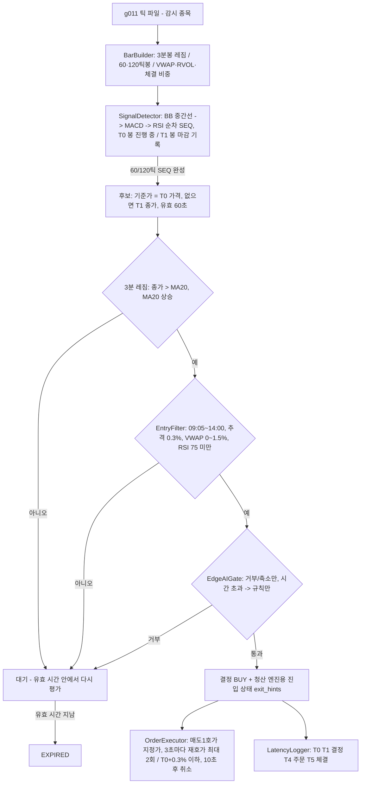

# 매수(진입) 엔진 1단계 원인 분석 (2026-11-15)

요청: 매수 체결이 첫 신호보다 늦고 0.5~1% 비싸며 매수 직후 하락이 잦다 -> 지연 분해, 가설 H1~H5 판정. 코드 수정 없이 기존 로그와 데이터로 분석했다.
도구: `data_simulation/g033_entry_latency.py` (`--stage ticks` 틱 기반 분해, `--stage bbmid` 1분 BB 중간선 기준).
결과: `runtime/data/sim/g033/20261115_195322/` (report.md, real_buys.csv, crosses.csv), `runtime/data/sim/g033/bbmid_20261115_200037/`.

## 0. 요청서와 실제 구조의 차이

가정: 요청서의 "BB 중간선 돌파 -> MACD -> RSI 순차 확인"은 현재 코드와 다르다. 분석은 **실제 코드** 기준이다.

| 단계 | 실제 (r005, ENTRY_TRIGGER_MODE="triple") |
|---|---|
| 트리거 `_009` | 1분 MA5 > MA20 **상태**(15분 이내) + 60틱 또는 120틱 MA5 x MA20 **교차**(4분 이내), 교차 봉 종가 대비 추격 0.5% 이하 |
| 컨텍스트 `_011~_014` | 3분봉 준비, 1분·3분 ATR% 하한, 유동성, 가점 기록(임계값 없음) |
| 주문 직전 `_015~_025` | 전일 대비 상승 상한, 당일 과열(시가/VWAP), 개장 갭, Edge AI 게이트, 호가 비용, **연속 2회 확인**, 수량, 현재가 신선도, 호가 잔량 |
| 주문 | 시장가 + 지정가(매수1호가) 분할, 지정가 미체결 10초 후 정정(최대 3회, 0.5% 한도) |

MACD·RSI 는 트리거 경로에 없다(3분 가점 기록뿐). 그래서 요청서의 T2(MACD)/T3(RSI) 는 다음으로 바꿔 계측했다:
T1L = r003 이 교차를 처음 본 시각, TP = 모든 조건을 처음 1회 통과한 시각(`BUY HOLD 1/2`), T4 = 주문(`BUY SUBMIT`), T5 = 체결(매수 블록 평균가).
1분 BB 중간선 = 1분 MA20 이다(같은 값).

## 1. 지연 분해

### 1.1 틱 기준 (틱 파일이 있는 11거래일, 10/30~11/13, 실매수 29건) - 평균 / 중앙값

| 구간 | 시간(초) | 가격 변화(%) |
|---|---|---|
| T0 틱봉 내부 교차 -> T1 틱봉 마감 | 59 / 61 | +0.03 / 0.00 |
| T1 -> T1L r003 인지 (메인 루프 순회) | 18 / 14 | +0.01 / 0.00 |
| T1L -> TP 모든 조건 1회 통과 | 36 / 1 | +0.00 / 0.00 |
| TP -> T4 연속 2회 확인 | 28 / 19 | +0.04 / 0.00 |
| T4 -> T5 체결 (주문 시점 체결가 대비) | - | +0.03 / +0.01 |
| 슬리피지: 판정 현재가 대비 체결가 | - | +0.05 / +0.05 |
| **합계 T0 -> 체결가** | **135 / 133** | **+0.11 / +0.13** |

- 60틱 트리거 23건: T0->T1 54초, T0->체결가 +0.16%. 120틱 6건: 77초, -0.06%(표본 작음).
- T1L->T4 를 늦춘 조건(마지막 반려 사유, 반려가 있던 12건): 교차 대비 추격 한도 4, 1분 MA5>MA20 미충족 3, 캔들 추격 가드 2,
  시장 추세 1, 틱 교차 만료 1, 기타 1. 나머지 17건은 반려 없이 연속 확인만 거쳤다.

### 1.2 1분 BB 중간선 기준 (실매수 196건, 09/08~11/13, 틱 불필요) - 사용자가 보는 "첫 신호"

| 기준 (매수 전 60분 안의 마지막 신호) | 경과(초) | 체결가 차이(%) |
|---|---|---|
| 1분 종가가 BB 중간선을 상향 돌파한 봉의 종가 | 357 / 212 | **+0.50 / +0.32** |
| 같은 봉의 BB 중간선 값(장중 돌파 가격) | - | **+0.84 / +0.62** |
| 1분 MA5 x MA20 골든크로스 봉 종가 | 733 / 449 | +0.65 / +0.46 |

- 체감("0.5~1% 비싸다")은 1분 BB 중간선 기준으로 맞다. 지연의 대부분(약 6~12분)은 **"1분 MA5 > MA20" 이 될 때까지 기다리는 구조**
  때문이다. 틱 교차가 난 뒤 체결까지는 2분 남짓, +0.11% 다. 주문·체결(슬리피지 +0.05%)은 원인이 아니다.

### 1.3 매수 후 결과 (틱 기준 29건, 체결가 기준, 비용 전)

| 창 | MFE | MAE | 종료 수익 |
|---|---|---|---|
| 5분 | +0.50 / +0.43 | -0.56 / -0.52 | -0.07 / -0.20 |
| 10분 | +0.68 / +0.54 | -0.95 / -0.65 | -0.37 / -0.33 |
| 30분 | +0.83 / +0.63 | -1.55 / -1.17 | -0.78 / -0.21 |

- T0 가격으로 샀다면(같은 종료 시각): -0.61 / -0.08 (실제 -0.78 / -0.21). 평균 0.16%p 개선, 표본 28건.
- "매수 직후 하락"은 사실이다(10분 안에 MAE 가 MFE 보다 크다). 하지만 T0 에 샀어도 MAE -1.42% 로 거의 같다.

## 2. 가설 판정

| 가설 | 판정 | 근거 |
|---|---|---|
| H1 후행 지표를 연달아 확인해 상승 후반에 진입 | **가격은 맞음, 손실 원인은 아님** | 1분 BB 중간선 돌파 대비 +0.50%(중간선 값 대비 +0.84%), 약 6분 늦다. 그러나 (a) 실매수 196건을 돌파 대비 체결가 차이 구간으로 나누면 실현 손익이 더 나빠지지 않는다(차이 0% 이하 -0.52%, 1% 초과 +0.09%, 중앙값은 모두 -0.5~-0.7%). (b) r003 이 본 틱 교차 1,167건에서 T0 에 사든 T1+180초에 사든 30분 수익이 -0.22% -> -0.27% 로 0.05%p 차이다 |
| H2 봉 마감 판정 때문에 1분봉 지연이 큼 | **부분적으로 맞음** | 1분봉은 마감을 기다리는 트리거가 아니라 "MA5>MA20 상태" 조건이다. 이 상태가 되기까지가 가장 긴 지연(1분 MA 골든크로스 봉 대비 733초 / +0.65%)이다. 틱봉 마감 대기는 60틱 57초 / +0.02%, 120틱 108초 / +0.03%(교차 1,167건)로 작다 |
| H3 시장가·추격 주문 때문에 슬리피지가 큼 | **틀림** | 판정 현재가 대비 체결가 +0.05%(약 0.3틱), 주문 시점 체결가 대비 +0.03% |
| H4 과열 상태에서 매수 | **데이터 부족** | 매수 시점 3분 RSI 평균 58.7, %B 0.49(중심선과 상단의 중간). RSI>=70 6건의 30분 수익 -1.05% vs 나머지 -0.70%(23건) - 방향은 맞지만 표본이 너무 작다. 이미 당일 과열 차단(_016)과 캔들·BB 갭 추격 가드가 있다 |
| H5 거래량 없는 가짜 돌파를 못 거름 | **틀림 (이 데이터에서)** | 교차 틱봉 거래량/직전 20봉 비율 구간별 30분 수익: 0.7 이하 -0.11%, 0.7~1.0 -0.38%, 1.0~1.5 -0.23%, 1.5~2.5 -0.27%, 2.5 초과 -0.08%. 매수 체결 비중 구간도 단조 관계 없음(교차 1,167건). 이전 연구(analysis_20261111 §8.6)도 강한 매수 체결 직후 진입이 더 나빴다 |

추가로 확인된 것:
- **r003 이 교차를 늦게 본다**: 틱봉 마감 후 평균 18초(중앙값 14초). 메인 루프가 감시 종목을 순서대로 돌며 종목마다 REST 를 호출하기 때문이다.
  가격 영향은 +0.01% 로 작다.
- 시간대(틱 교차 1,167건, T1 기준 30분 수익): 09시대 -0.60%, 10시대 -0.09%, 10~12시 -0.25%, 12시 이후 -0.09%. 장 초반이 가장 나쁘다.
- 가격대: 1만원 이하 -1.63%(50건), 1~5만원 -0.24%, 5~20만원 -0.14%, 20만원 이상 -0.14%. 저가주가 크게 나쁘다(호가단위 비용, §5 of analysis_20261111 과 같은 방향).
- 교차 자체의 기대값이 비용 전에도 음수다: T0 에 사도 30분 수익 -0.22%(비용 0.23% 별도). 진입을 앞당겨도 비용을 넘는 수익이 생기지 않는다.
  이는 이전 연구(analysis_20261111 §0, §10)와 같은 결론이다.

## 3. 결론 (1단계)

1. 지연은 실재한다. 사용자가 보는 1분 BB 중간선 돌파 대비 약 6분, +0.5%(돌파 가격 대비 +0.8%). 가장 큰 원인은 "1분 MA5>MA20 상태 + 틱 교차"를
   모두 기다리는 트리거 구조다. 주문 방식·슬리피지는 원인이 아니다.
2. 그러나 **지연이 손실의 원인이라는 근거는 없다.** 같은 교차에서 일찍 사도 결과가 거의 같고(0.05%p), 늦게 산 실매수가 더 나쁘지도 않다.
   손실의 원인은 진입 신호 자체의 기대값이 0 이하(비용 전 -0.2%)라는 점이다.
3. 그래서 3단계에서 "더 빨리 사는" 개선(봉 진행 중 판정, 추격 한도 강화, 눌림 진입)은 체결가를 0.1~0.5% 낮출 수는 있어도 거래당 손익을 비용
   이상으로 바꿀 가능성이 낮다. 2단계 봉 구성 비교에서 이 점을 같은 데이터로 확인한 뒤 구현 범위를 정하자는 것이 제안이다.

## 4. 데이터 부족 / 추가로 필요한 데이터

| 항목 | 상태 | 필요 |
|---|---|---|
| 틱 기준 실매수 | 29건(11거래일) | 이 PC 로그에 11/05, 11/06, 11/09, 11/12 매수가 없다. 그날 라즈베리파이에서 매매했다면 **라즈베리파이 runtime/log 의 해당 날짜 폴더** 를 복사해 달라 |
| 호가(잔량) 이력 | 없음 | 호가 불균형 지표(요청 2단계)는 데이터가 없어 검증 불가. g011 은 1호가 가격만 저장한다 - 10호가 잔량 수집을 추가해야 한다 |
| 체결 시각 | 근사 | T5 는 매수 블록 로그 시각(체결 확인 시각)이다. KIS 체결 조회의 체결 시각을 기록하면 정확해진다(3단계 LatencyLogger) |
| 종목 유형·시간대별 실매수 비교 | 표본 부족 | 실매수 29건으로는 나눌 수 없다. 2단계에서 틱 교차 1,167건 + 1분 신호 전수로 본다 |
| H4 과열 | 표본 부족 | RSI>=70 실매수 6건 |

## 5. 다음 단계 제안 (확인 후 진행)

- 2단계(봉 구성 비교 A~F x 지표 조합): 틱 파일 11거래일(10/30~11/13)로 실행 가능하다. 1분/3분봉 단독(A/B)은 90거래일
  분봉으로 표본을 늘릴 수 있다. 체결 모델은 신호 다음 틱 + 1틱 슬리피지, 비용 0.23%, 매도는 오늘 실매매에 연결한 적응형 청산 엔진(r024)을
  같은 조건으로 쓴다. 학습 = 앞 2/3, 검증 = 뒤 1/3(봉인), 날짜 단위 워크포워드.
- 3단계 범위는 2단계 결과로 정한다. 결과와 관계없이 넣을 만한 것: 상시 지연 계측(LatencyLogger, 주문 경로 무변경), 추격 한도를 "T0 가격 대비"로
  바꾸는 옵션, 저가주(1만원 이하)·장 초반 제한 검토.

---

# 2~4단계 (2026-11-15, 사용자 확인 "2,3단계 진행한다")

## 6. 2단계: 봉 구성 비교 (g034)

도구: `data_simulation/g034_entry_bar_study.py`. 결과: `runtime/data/sim/g034/w10_20261115/` (report.md, trades.csv, signals.csv).
데이터: 틱 파일이 있는 11거래일(10/30~11/13), 종목-일 237개(감시 종목만).

**체결·청산 모델(모든 구성 동일)**
- 진입: 신호가 쓸 수 있게 된 시각 + 1초 뒤 첫 체결의 매도1호가에 삽니다(봉 종가 체결 가정 없음).
- 청산: r024 적응형 엔진 틱 리플레이로 판정합니다(오늘 실매매에 연결한 매도 엔진).
- 손익: 수수료 양방향과 세금을 뺀 순손익 % 입니다.

**가정**
- "BB 중간선 돌파 -> MACD -> RSI" 의 각 신호는 다음처럼 정의했습니다.
  - BB 돌파: 종가가 MA20 을 상향 돌파합니다.
  - MACD 신호: MACD 선이 시그널 선을 상향 돌파합니다(히스토그램이 양수로 전환).
  - RSI 신호: RSI(14) 가 50 을 상향 돌파합니다.
  - 연달아: 순서대로 발생하고, 각 단계가 앞 단계 뒤 W 봉 안에 나와야 합니다(W=10).
- E 는 현행과 같이 "1분 + (60틱 또는 120틱)" 입니다(요청서의 "동시 조건" 은 현행 코드상 OR 입니다).
- E_live 는 실제 r005 _009 트리거를 10초마다 재현한 것입니다. 주문 직전 게이트(_011~_025)는 어느 구성에도 넣지 않았습니다.
- 호가 불균형은 **데이터 부족**입니다(g011 은 1호가 가격만 저장).

**결과 요약 (기대값 = 건당 순손익 % 평균)**

| 구성 | 거래 | 승률 | 기대값 | 검증 구간(11/10~13) |
|---|---|---|---|---|
| E_live 현행 트리거 | 1,229 | 22% | -0.50 | -0.54 |
| A 1분 SEQ / LEAD | 806 / 103 | 18% / 25% | -0.50 / -0.35 | -0.51 / -0.33 |
| B 3분 SEQ | 258 | 18% | -0.52 | -0.65 |
| C 60틱 SEQ | 559 | 26% | -0.40 | -0.46 |
| D 120틱 SEQ | 278 | 28% | -0.40 | -0.48 |
| E 1분+틱 SEQ | 241 | 17% | -0.41 | -0.47 |
| **F3 3분 레짐 + 60/120틱 SEQ** | 224 | 33% | **-0.36** | **-0.29** |
| 모든 구성 MA(MA5xMA20) 조합 | - | - | -0.48 ~ -0.53 | - |

- **모든 구성이 비용 후 음수입니다.** 가장 나은 구성도 -0.3% 안팎입니다.
- 워크포워드(확장 창, 날마다 이전 날 최고 구성 선택)는 168건 -0.40%, 현행은 790건 -0.50% 입니다.
- 지표 조합 순서는 SEQ(순차 확인) > WIN(창 안 동시) ≈ MA 입니다. 요청서의 가정과 반대로, 순차 확인이 거래를 줄여 오히려 낫습니다.
- 봉 종류는 틱봉 트리거(C/D/F) > 1분/3분 단독(A/B) 입니다.
- W(단계 간 봉 수) 민감도: W=5/10/15 에서 F3/SEQ -0.37/-0.36/-0.36, C/SEQ -0.41/-0.40/-0.40, D/SEQ -0.40/-0.40/-0.40 으로 거의 같습니다(runtime/data/sim/g034/w5_, w15_).

**선행 지표 (모든 BB 돌파, 비용 전 30분 수익)**
- VWAP 위 0~1.5% 일 때가 가장 좋습니다(60·120틱 +0.01~+0.04%). VWAP 아래이거나 1.5% 넘게 위면 나쁩니다(-0.15~-0.32%).
  이격이 과하면 나쁘다는 점은 H4 와 같은 방향입니다.
- RVOL, 체결강도 변화, 가속도는 단조 관계가 없습니다(H5 를 다시 확인).

**종목 유형·시간대**
- 14:00~14:50 진입이 거의 모든 구성에서 가장 나쁩니다.
- 가격대·유동성 효과는 구성마다 방향이 다릅니다. 이 데이터로는 결론을 낼 수 없습니다.

**청산 쪽 발견(범위 밖, 참고)**
- 같은 진입에서 r024 엔진 결과가 "30분 보유 후 매도" 보다 건당 약 0.1~0.15%p 나쁩니다.
- 엔진 청산의 73% 가 20분 TIME_STOP 입니다.
- 이는 진입 개선폭과 비슷한 크기라서 매도 엔진 파라미터 재검토가 필요합니다.

## 7. 3단계: 개선 진입 엔진 r028 (구현)

파일:
- `live_trading/r028_entry_engine.py`: 7개 모듈과 r003 shadow 서비스.
- `live_trading/r028_entry_engine.yaml`: 파라미터.
- r001 `ENTRY_ENGINE_MODE`(기본 "shadow"), `ENTRY_ENGINE_CONFIG`.
- r003 연결.

| 파라미터 | 기본값 | 범위(민감도) | 근거 |
|---|---|---|---|
| 레짐 봉 | 3분 | 1분이면 -0.45 | g034 F3 > F1, g035 regime_1m |
| 트리거 봉 | 60·120틱 | - | g034 C/D/F > A/B |
| 조합 | SEQ | MA 면 -0.47 | g034/g035 |
| W(단계 간 봉 수) | 10 | 5: -0.27, 15: -0.27 | g035 - 결과가 거의 같음 |
| 신호 유효 시간 | 60초 | 30초: -0.25, 180초: -0.22 | g035 - 180초가 조금 낫지만 잡음 범위 |
| 추격 한도(T0 대비) | 0.3% | 0.15: -0.31, 0.5: -0.26 | 요청서 값. 결과에 거의 영향 없음(SEQ 슬리피지 +0.05%) |
| VWAP 범위 | 0 ~ +1.5% | 끄면 -0.32 | g034 §5 선행 지표, g035 vwap_off |
| 진입 시간 | 09:05~14:00 | 14:50 까지면 -0.31 | g034 시간대 표 |
| RSI 상한 | 75 | 70: -0.28 (같음) | **가정**(H4 데이터 부족) |
| 봉 진행 중 판정 | 끔 | 켜면 -0.30(95건) | g033: 봉 마감 대기 비용 +0.03%. 켜도 차이 없음 |
| 거래량·체결강도 확인 | 끔 | - | H5 틀림(g033, g034 §5) |
| Edge AI | 끔(veto 구조만) | - | 진입 모델이 검증되지 않았음. 켜도 거부·축소만 가능 |
| 주문 | 매도1호가 지정가, 재호가 2회, 10초 취소 | 시장가: -0.30 | 시장가로 쫓아가지 않습니다(**가정**) |

모든 기본값은 11거래일 데이터 기준입니다. **더 긴 기간과 모의투자로 확정해야 합니다.**

**구현 범위 - 가정·한계**
- r003 에는 **shadow 로만 연결**했습니다. 판단과 지연만 기록하고 주문하지 않습니다. 실제 매수는 기존 r005 경로 그대로입니다.
  - 근거 1: 4단계 요구(모의투자 후 실전).
  - 근거 2: 개선 후에도 기대값이 음수입니다.
- OrderExecutor 는 주문 계획 상태 기계입니다. 백테스트(g035)와 단위 테스트에서 씁니다. 실주문 경로에 연결하지 않았습니다.
- 청산 엔진 연계(항목 9): 결정에 `exit_hints`(레짐, 신호 봉, 추격 %, RSI, VWAP 이격)를 담아 기록합니다.
  r024 파라미터를 진입 상태에 따라 바꾸는 부분은 근거 데이터가 없어 넣지 않았습니다.
- LatencyLogger 는 실매수의 T4(첫 주문)와 T5(체결 확인)를 받습니다.
  - 엔진 후보(T0/T1)가 10분 안에 있으면 같은 기록에 붙입니다.
  - 그렇지 않으면 T4·T5 만 남깁니다.
  - 현행 트리거의 틱 교차 T0 는 여전히 g033 로그 분석으로 봅니다.

## 8. 4단계: 검증 (g035, 일부)

도구: `data_simulation/g035_entry_engine_replay.py`. r028 코드를 그대로 1초 단위로 리플레이합니다.
결과: `runtime/data/sim/g035/full2_20261115/report.md` (Codex 검토 수정 반영 후 재실행. 첫 실행은 full_20261115).

**기존 대비 개선 (같은 10거래일, 같은 청산)**

| | 거래 | 일 평균 | 승률 | 손익비 | 기대값 | MDD(%p) | 검증 구간 기대값 |
|---|---|---|---|---|---|---|---|
| 현행 트리거 E_live | 1,229 | 122.9 | 22% | 0.80 | -0.50 | 610 | -0.52 |
| r028 기본값 | 79 | 7.9 | 33% | 1.07 | **-0.28** | 25 | **-0.03** |

- 차이 +0.22%p 는 표준오차 약 0.13 의 1.7배입니다. **통계적으로 확실하지 않습니다.**
  - 날짜별로는 10일 중 6일 r028 이 낫습니다.
- 거래 수가 1/14 이라 하루 누적 손실(슬롯 합)은 크게 줄어듭니다.
  - 다만 실매매는 게이트를 거쳐 하루 몇 건만 사므로 이 비율이 그대로 적용되지 않습니다.
- parity 확인: 필터를 모두 끈 r028 은 182건 -0.35% 입니다. g034 F3/SEQ 는 224건 -0.36% 입니다.
  - 차이 원인 1: 3분봉 워밍업 출처(g034 = 10초 파일, r028 = 전일 틱 파일).
  - 차이 원인 2: 슬리피지 기준가(r028 = T0 가격).
  - 같은 종가를 넣으면 지표·신호가 정확히 같습니다(단위 테스트 IndicatorParityTest).
- 지연(LatencyLogger, 체결된 시도의 중앙값):
  - T0->T1 34초, T1->결정 0.8초, 결정->주문 1초, 주문->체결 0.8초.
  - 첫 신호 가격 -> 체결가 +0.05% 입니다(현행 실매수는 +0.11%, 1분 BB 기준 +0.50%).
- 가격대별 결과는 표본이 작아(가격대마다 10~40건) 필터로 쓰지 않았습니다.

**시나리오 테스트** (`tests/test_r028_entry_engine.py`, 합성 틱: 1초 1체결, 10틱봉, 1분 레짐)

| 시나리오 | 입력 | 기대 동작 | 테스트 |
|---|---|---|---|
| 1. 진짜 돌파 | 상승 추세 -> 짧은 눌림 -> 회복(틱 MA 교차) | BUY 1건, T0 <= T1, exit_hints.regime=up | test_1 |
| 2. 가짜 돌파 후 하락 | BB 돌파 후 MACD/RSI 확인 전에 중간선 아래로 | 신호 없음(SEQ 초기화). 거래량으로 거르지는 않음(H5) | test_fake_breakout |
| 3. 늦게 완성, 이미 +0.8% | 신호 직후 +0.8% 로 유지 | 추격 한도로 거부 -> 유효 시간 지나 EXPIRED(CHASE_) | test_3 |
| 4. 돌파 후 눌림 재상승 | +0.8% 급등 후 신호 가격으로 되돌림 | 되돌림 후 BUY(유효 시간 안) | test_4 |
| 5. 09:00 이전 | 08:30~08:55 체결 | 봉·신호 없음 | test_5 |
| 6. 거래 적은 종목 | 2분에 1체결 | 틱봉이 거의 없어 신호 없음, 오류 없음 | test_6 |
| 7. Edge AI 시간 초과 | 0.2초 걸리는 모델, 제한 0.01초 | 규칙만으로 BUY(AI_TIMEOUT_RULES_ONLY) | test_7 |
| 8. 지정가 미체결 후 이탈 | 매도1호가가 계속 오름 | 3초 뒤 재호가(한도 T0+0.3% 안), 넘으면 재호가 안 함, 10초 뒤 취소 | OrderExecutorTest |

**아직 하지 않은 것**
- 모의투자(요청 4-5) - 아래 §9.
- 장기 워크포워드 - 틱 데이터가 11일뿐입니다.

## 9. 남은 위험·한계와 다음 단계

1. **개선 후에도 기대값이 음수입니다.** r028 은 손실을 줄이는 방향(-0.50 -> -0.28)일 뿐 수익을 내는 진입이 아닙니다.
   진입만 바꿔서는 비용 0.23% 를 넘기 어렵다는 1단계 결론이 2단계에서도 같았습니다.
2. 표본이 11거래일, 감시 종목뿐입니다. 결과가 감시 목록 선정 방식(g002)에 묶여 있습니다.
3. 지정가 체결 모델은 대기열을 무시합니다(그 가격 체결이 나오면 전량 체결로 가정). 실제 체결률은 더 낮을 수 있습니다.
4. 청산 엔진(r024)이 30분 보유보다 나쁜 점은 따로 봐야 합니다(§6).
5. 추가로 필요한 데이터:
   - 10호가 잔량(호가 불균형).
   - KIS 체결 조회의 실제 체결 시각.
   - 라즈베리파이 11/05·06·09·12 로그.
   - 틱 수집 기간 연장(최소 30거래일).
6. 제안 순서:
   1. r028 shadow 를 실매매와 함께 2주 이상 돌려 실제 지연과 판단을 쌓습니다.
   2. g035 로 shadow 판단을 다시 채점합니다.
   3. 개선이 유지되면 실주문 연결("live" 모드: OrderExecutor 를 r003 주문 경로에 연결)을 별도로 검토합니다.

## 10. Codex 검토 (r028 + r003 shadow 연결)

| 차수 | 결론 | 내용 | 기록 |
|---|---|---|---|
| 1 | 수정 후 가동 | 8건: 워커가 r003 로거 공유(높음), 시간봉 확정 지연 위반, trim 빈도, 감시 제외 종목 평가, 지연 기록 짝짓기, 전일 미완성 봉, AI 타임아웃, 종료 시 기록 유실 | entry_engine_codex_review_20261115.md |
| 2 | 수정 후 가동 | 5건 해결. 남은 3건: 주문 뒤 판단 시각 복사, 지연이 봉 길이 이상일 때 pending 강제 확정, 종료 완료 보장 | entry_engine_codex_rereview_20261115.md |
| 3 | **shadow 가동 가능** | 3건 해결, 새 결함 없음, 실매매 루프·주문 영향 없음 | entry_engine_codex_final_20261115.md |

모든 지적에는 테스트를 붙였습니다(tests/test_r028_entry_engine.py 42개).
